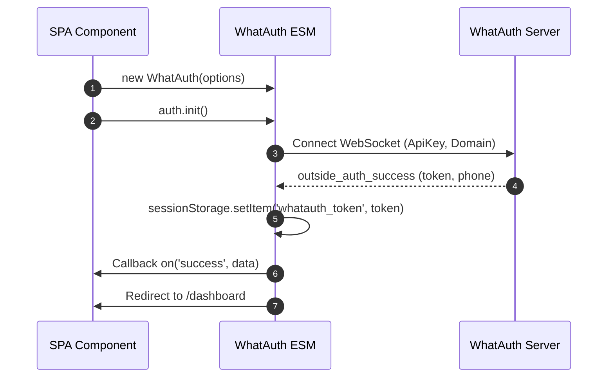
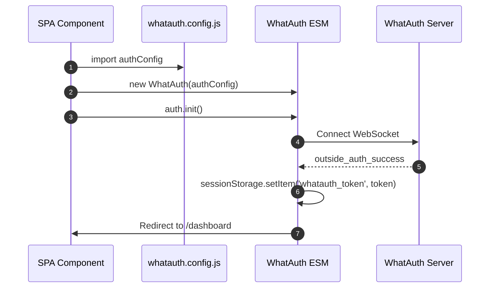
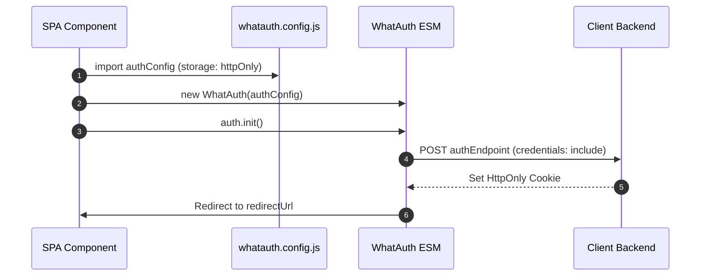

# WhatAuth ESM SDK

Integrationsleitfaden für das WhatAuth ES Module SDK für moderne Frameworks (React, Vue, Angular, Svelte, Next.js) und Browser mit nativer ES-Modulunterstützung.

---

## Voraussetzungen

1. Konto auf whatauth.com registrieren
2. Einen aktiven Lizenzplan besitzen
3. Im Bereich LoginQR: QR-Code mit Domäne, Text, Emojis und JWT-Secret anpassen
4. Einen öffentlichen ApiKey im Bereich API erstellen

---

## 1. Direkter CDN-Import (ES-Module)

Das Modul exportiert die Klasse `WhatAuth`, die über reaktive Ereignisse verwaltet wird.

### sessionStorage-Modus

Speichert das JWT-Token automatisch im sessionStorage des Browsers (`whatauth_token`) und leitet den Benutzer weiter.

```javascript
import { WhatAuth } from 'https://cdn.whatauth.com/v1.0.0/whatauth.esm.js';

const auth = new WhatAuth({
  apiKey: 'wk_live_create_in_dashboard_apikey',
  wsUrl: 'https://api.whatauth.com',
  storage: 'sessionStorage',
  redirectUrl: '/dashboard',
  domain: window.location.host
});

auth.on('connected', (data) => {
  console.log('Socket connected:', data.socketId);
});

auth.on('success', (data) => {
  console.log('Authentication successful:', data.phone);
});

auth.on('error', (err) => {
  console.error('Authentication error:', err);
});

auth.init();
```



### httpOnly-Modus

Sendet das Token per POST-Anfrage mit Anmeldeinformationen an Ihr Backend, um sichere HttpOnly-Cookies zu setzen.

```javascript
import { WhatAuth } from 'https://cdn.whatauth.com/v1.0.0/whatauth.esm.js';

const auth = new WhatAuth({
  apiKey: 'wk_live_create_in_dashboard_apikey',
  wsUrl: 'https://api.whatauth.com',
  storage: 'httpOnly',
  authEndpoint: '/api/auth/login',
  redirectUrl: '/dashboard',
  domain: window.location.host
});

auth.on('authEndpointSuccess', (data) => {
  console.log('Secure session cookie set:', data);
});

auth.on('authEndpointError', (err) => {
  console.error('Backend exchange error:', err);
});

auth.init();
```

```mermaid
sequenceDiagram
    autonumber
    participant App as SPA Component
    participant SDK as WhatAuth ESM
    participant API as Client Backend
    participant WS as WhatAuth Server
    App->>SDK: auth.init()
    SDK->>WS: Connect WebSocket
    WS-->>SDK: outside_auth_success (token, phone)
    SDK->>API: POST authEndpoint (token, credentials: include)
    API-->>SDK: 200 OK + Set-Cookie (HttpOnly; Secure)
    SDK->>App: Redirect to /dashboard
```

---

## 2. Konfigurationsdatei whatauth.config.js

Lagert die Optionen in ein exportierbares Modul aus, das in jeder Komponente wiederverwendet werden kann.

### sessionStorage-Modus mit Config

```javascript
// whatauth.config.js
export const authConfig = {
  apiKey: 'wk_live_create_in_dashboard_apikey',
  wsUrl: 'https://api.whatauth.com',
  domain: window.location.host,
  storage: 'sessionStorage',
  redirectUrl: '/dashboard'
};
```

```javascript
import { WhatAuth } from 'https://cdn.whatauth.com/v1.0.0/whatauth.esm.js';
import { authConfig } from './whatauth.config.js';

const auth = new WhatAuth(authConfig);
auth.init();
```



### httpOnly-Modus mit Config

```javascript
// whatauth.config.js
export const authConfig = {
  apiKey: 'wk_live_create_in_dashboard_apikey',
  wsUrl: 'https://api.whatauth.com',
  domain: window.location.host,
  storage: 'httpOnly',
  authEndpoint: '/api/auth/login',
  redirectUrl: '/dashboard'
};
```

```javascript
import { WhatAuth } from 'https://cdn.whatauth.com/v1.0.0/whatauth.esm.js';
import { authConfig } from './whatauth.config.js';

const auth = new WhatAuth(authConfig);
auth.init();
```



---

## 3. Konfigurationsoptionsmatrix

| Eigenschaft | Typ | Beschreibung |
|---|---|---|
| `apiKey` | `String` | Öffentlicher API-Schlüssel aus dem Dashboard (wk_live_create_in_dashboard_apikey). Erforderlich. |
| `wsUrl` | `String` | WebSocket-Serveradresse (https://api.whatauth.com). |
| `domain` | `String` | Autorisierte Domäne. Standard: window.location.host. |
| `storage` | `String` | Sitzungsmodus: "sessionStorage" oder "httpOnly". |
| `redirectUrl` | `String` | Automatische Weiterleitungsroute nach erfolgreicher Prüfung. |
| `authEndpoint` | `String` | POST-Endpunkt, ausschließlich im "httpOnly"-Modus erforderlich. |
| `qrId` | `String` | DOM-ID für den QR-Container/Bild (Standard: "whatauth-qr"). |
| `linkId` | `String` | DOM-ID für WhatsApp-Schaltfläche/Link (Standard: "whatauth-link"). |
| `expiredId` | `String` | DOM-ID für die Ablaufmeldung (Standard: "whatauth-expired"). |
| `statusId` | `String` | DOM-ID für den Status-Container (Standard: "whatauth-status"). |
| `pinId` | `String` | DOM-ID für den numerischen PIN-Container (Standard: "whatauth-pin"). |
| `sessionDuration` | `Number` | Sitzungsablaufzeit in Sekunden (Standard: 300). |
