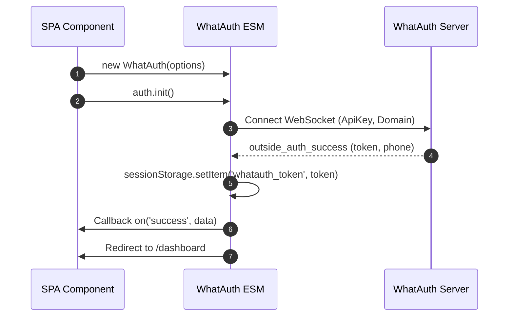
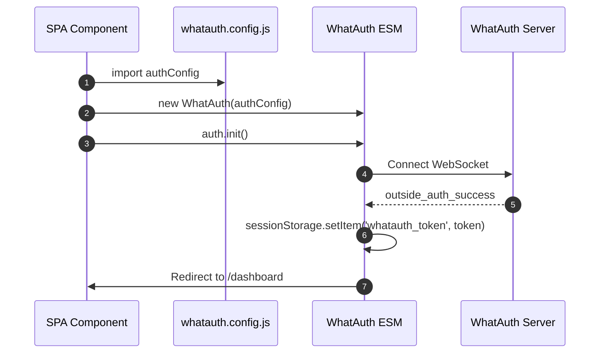
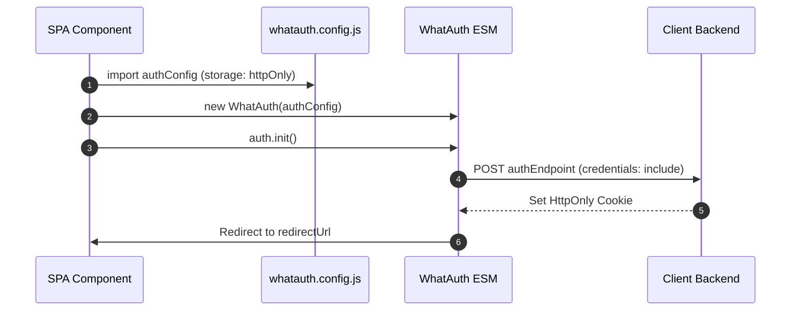

# WhatAuth ESM SDK

Integration guide for the WhatAuth ES Module SDK designed for modern frameworks (React, Vue, Angular, Svelte, Next.js) and native browser module imports.

---

## Prerequisites

1. Sign up at whatauth.com
2. Have an active license plan
3. In the LoginQR section: customize the QR with domain, phrase, emojis, and JWT Secret
4. Create a public ApiKey in the API section

---

## 1. Direct CDN Import (ES Modules)

The module exports the `WhatAuth` class, managed via standard instance lifecycle and reactive events.

### sessionStorage Mode

Automatically persists the signed JWT token in browser sessionStorage (`whatauth_token`) and triggers optional redirection.

```javascript
import { WhatAuth } from 'https://cdn.whatauth.com/v1.0.0/whatauth.esm.js';

const auth = new WhatAuth({
  apiKey: 'wk_live_create_in_dashboard_apikey',
  wsUrl: 'https://api.whatauth.com',
  storage: 'sessionStorage',
  redirectUrl: '/dashboard',
  domain: window.location.host
});

auth.on('connected', (data) => {
  console.log('Socket connected:', data.socketId);
});

auth.on('success', (data) => {
  console.log('Authentication successful:', data.phone);
});

auth.on('error', (err) => {
  console.error('Authentication error:', err);
});

auth.init();
```



### httpOnly Mode

Dispatches the token via POST request with credentials to your backend server to establish secure HttpOnly session cookies.

```javascript
import { WhatAuth } from 'https://cdn.whatauth.com/v1.0.0/whatauth.esm.js';

const auth = new WhatAuth({
  apiKey: 'wk_live_create_in_dashboard_apikey',
  wsUrl: 'https://api.whatauth.com',
  storage: 'httpOnly',
  authEndpoint: '/api/auth/login',
  redirectUrl: '/dashboard',
  domain: window.location.host
});

auth.on('authEndpointSuccess', (data) => {
  console.log('Secure session cookie set:', data);
});

auth.on('authEndpointError', (err) => {
  console.error('Backend exchange error:', err);
});

auth.init();
```

```mermaid
sequenceDiagram
    autonumber
    participant App as SPA Component
    participant SDK as WhatAuth ESM
    participant API as Client Backend
    participant WS as WhatAuth Server
    App->>SDK: auth.init()
    SDK->>WS: Connect WebSocket
    WS-->>SDK: outside_auth_success (token, phone)
    SDK->>API: POST authEndpoint (token, credentials: include)
    API-->>SDK: 200 OK + Set-Cookie (HttpOnly; Secure)
    SDK->>App: Redirect to /dashboard
```

---

## 2. External Configuration File whatauth.config.js

Decouples options into an exportable module reusable across any component or app.

### sessionStorage Mode with Config

```javascript
// whatauth.config.js
export const authConfig = {
  apiKey: 'wk_live_create_in_dashboard_apikey',
  wsUrl: 'https://api.whatauth.com',
  domain: window.location.host,
  storage: 'sessionStorage',
  redirectUrl: '/dashboard'
};
```

```javascript
import { WhatAuth } from 'https://cdn.whatauth.com/v1.0.0/whatauth.esm.js';
import { authConfig } from './whatauth.config.js';

const auth = new WhatAuth(authConfig);
auth.init();
```



### httpOnly Mode with Config

```javascript
// whatauth.config.js
export const authConfig = {
  apiKey: 'wk_live_create_in_dashboard_apikey',
  wsUrl: 'https://api.whatauth.com',
  domain: window.location.host,
  storage: 'httpOnly',
  authEndpoint: '/api/auth/login',
  redirectUrl: '/dashboard'
};
```

```javascript
import { WhatAuth } from 'https://cdn.whatauth.com/v1.0.0/whatauth.esm.js';
import { authConfig } from './whatauth.config.js';

const auth = new WhatAuth(authConfig);
auth.init();
```



---

## 3. Configuration Options Matrix

| Property | Type | Description |
|---|---|---|
| `apiKey` | `String` | Public API key generated in console (wk_live_create_in_dashboard_apikey). Required. |
| `wsUrl` | `String` | WebSocket server URL (https://api.whatauth.com). |
| `domain` | `String` | Authorized domain. Defaults to window.location.host. |
| `storage` | `String` | Session mode: "sessionStorage" or "httpOnly". |
| `redirectUrl` | `String` | Automatic navigation route after successful scan. |
| `authEndpoint` | `String` | POST endpoint required exclusively in "httpOnly" mode. |
| `qrId` | `String` | DOM ID for the container or image of the QR (def: "whatauth-qr"). |
| `linkId` | `String` | DOM ID for WhatsApp button/link (def: "whatauth-link"). |
| `expiredId` | `String` | DOM ID for expiration overlay (def: "whatauth-expired"). |
| `statusId` | `String` | DOM ID for status message container (def: "whatauth-status"). |
| `pinId` | `String` | DOM ID for numeric PIN container (def: "whatauth-pin"). |
| `sessionDuration` | `Number` | Session expiration time in seconds (def: 300). |
