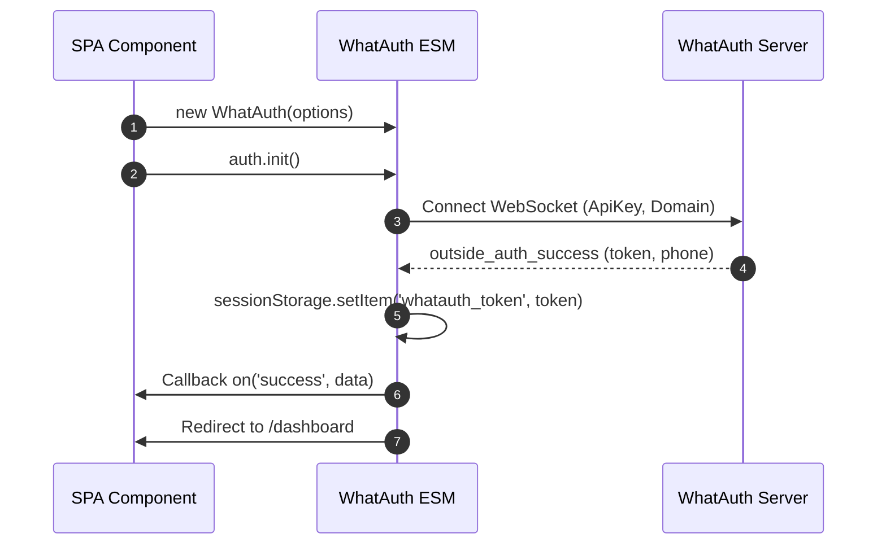
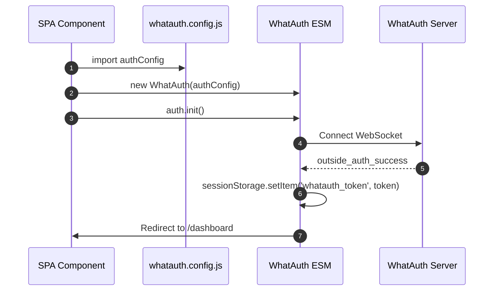
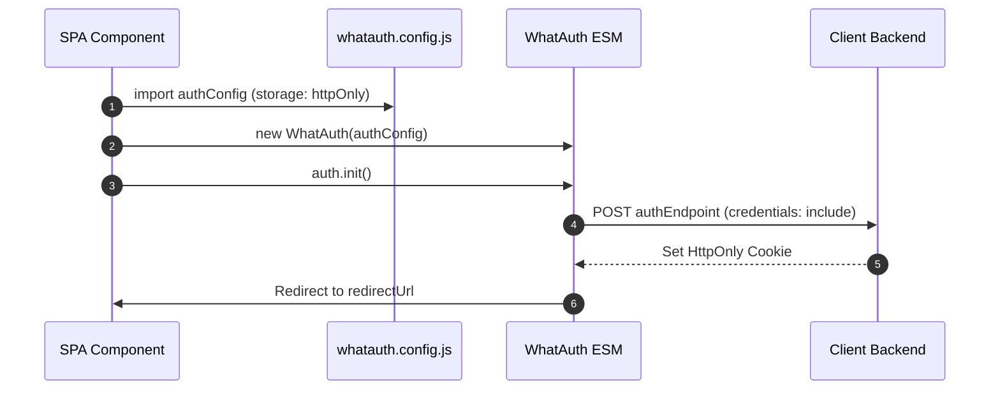

# WhatAuth ESM SDK

Guía de integración del SDK ESM de WhatAuth para frameworks modernos (React, Vue, Angular, Svelte, Next.js) y navegadores con soporte nativo de módulos ES.

---

## Requisitos Previos

1. Registrarse en whatauth.com
2. Tener una licencia activa
3. En la sección LoginQR: personalizar el QR con dominio, frase, emojis y Secret JWT
4. Crear una ApiKey pública en la sección API

---

## 1. Importación Directa vía CDN (ES Modules)

El módulo exporta la clase `WhatAuth` que se instancia y gestiona mediante eventos reactivos.

### Modalidad sessionStorage

Guarda automáticamente el token JWT en el sessionStorage del navegador (`whatauth_token`) y redirige al usuario.

```javascript
import { WhatAuth } from 'https://cdn.whatauth.com/v1.0.0/whatauth.esm.js';

const auth = new WhatAuth({
  apiKey: 'wk_live_create_in_dashboard_apikey',
  wsUrl: 'https://api.whatauth.com',
  storage: 'sessionStorage',
  redirectUrl: '/dashboard',
  domain: window.location.host
});

auth.on('connected', (data) => {
  console.log('Socket connected:', data.socketId);
});

auth.on('success', (data) => {
  console.log('Authentication successful:', data.phone);
});

auth.on('error', (err) => {
  console.error('Authentication error:', err);
});

auth.init();
```



### Modalidad httpOnly

Envía el token mediante un POST con credenciales a tu backend para establecer cookies seguras HttpOnly.

```javascript
import { WhatAuth } from 'https://cdn.whatauth.com/v1.0.0/whatauth.esm.js';

const auth = new WhatAuth({
  apiKey: 'wk_live_create_in_dashboard_apikey',
  wsUrl: 'https://api.whatauth.com',
  storage: 'httpOnly',
  authEndpoint: '/api/auth/login',
  redirectUrl: '/dashboard',
  domain: window.location.host
});

auth.on('authEndpointSuccess', (data) => {
  console.log('Secure session cookie set:', data);
});

auth.on('authEndpointError', (err) => {
  console.error('Backend exchange error:', err);
});

auth.init();
```

```mermaid
sequenceDiagram
    autonumber
    participant App as SPA Component
    participant SDK as WhatAuth ESM
    participant API as Client Backend
    participant WS as WhatAuth Server
    App->>SDK: auth.init()
    SDK->>WS: Connect WebSocket
    WS-->>SDK: outside_auth_success (token, phone)
    SDK->>API: POST authEndpoint (token, credentials: include)
    API-->>SDK: 200 OK + Set-Cookie (HttpOnly; Secure)
    SDK->>App: Redirect to /dashboard
```

---

## 2. Archivo de Configuración whatauth.config.js

Desacopla la configuración en un archivo exportable para reutilizar en cualquier componente o aplicación.

### Modalidad sessionStorage con Config

```javascript
// whatauth.config.js
export const authConfig = {
  apiKey: 'wk_live_create_in_dashboard_apikey',
  wsUrl: 'https://api.whatauth.com',
  domain: window.location.host,
  storage: 'sessionStorage',
  redirectUrl: '/dashboard'
};
```

```javascript
import { WhatAuth } from 'https://cdn.whatauth.com/v1.0.0/whatauth.esm.js';
import { authConfig } from './whatauth.config.js';

const auth = new WhatAuth(authConfig);
auth.init();
```



### Modalidad httpOnly con Config

```javascript
// whatauth.config.js
export const authConfig = {
  apiKey: 'wk_live_create_in_dashboard_apikey',
  wsUrl: 'https://api.whatauth.com',
  domain: window.location.host,
  storage: 'httpOnly',
  authEndpoint: '/api/auth/login',
  redirectUrl: '/dashboard'
};
```

```javascript
import { WhatAuth } from 'https://cdn.whatauth.com/v1.0.0/whatauth.esm.js';
import { authConfig } from './whatauth.config.js';

const auth = new WhatAuth(authConfig);
auth.init();
```



---

## 3. Matriz de Opciones de Configuración

| Propiedad | Tipo | Descripción |
|---|---|---|
| `apiKey` | `String` | Clave pública de la API generada en el panel (wk_live_create_in_dashboard_apikey). Obligatorio. |
| `wsUrl` | `String` | URL del servidor WebSocket (https://api.whatauth.com). |
| `domain` | `String` | Dominio registrado de la API Key. Por defecto window.location.host. |
| `storage` | `String` | Estrategia de sesión: "sessionStorage" o "httpOnly". |
| `redirectUrl` | `String` | Ruta de redirección automática tras autenticación exitosa. |
| `authEndpoint` | `String` | Endpoint POST requerido únicamente en modo "httpOnly". |
| `qrId` | `String` | ID del elemento contenedor o imagen para el QR (def: "whatauth-qr"). |
| `linkId` | `String` | ID del botón o enlace directo a WhatsApp (def: "whatauth-link"). |
| `expiredId` | `String` | ID del contenedor de sesión expirada (def: "whatauth-expired"). |
| `statusId` | `String` | ID del contenedor de mensajes de estado (def: "whatauth-status"). |
| `pinId` | `String` | ID del contenedor para el PIN numérico (def: "whatauth-pin"). |
| `sessionDuration` | `Number` | Tiempo de expiración de la sesión en segundos (def: 300). |
