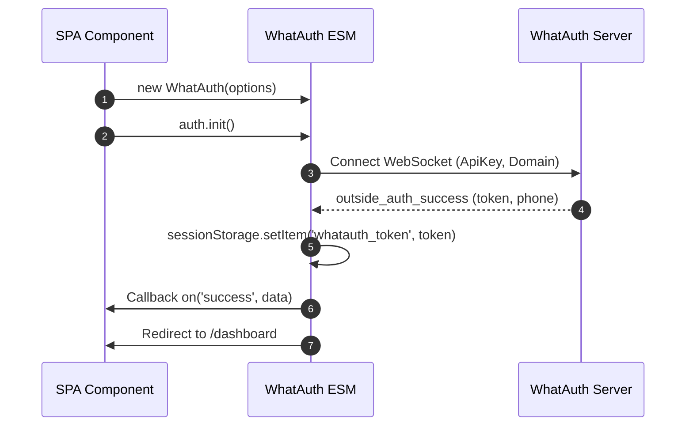
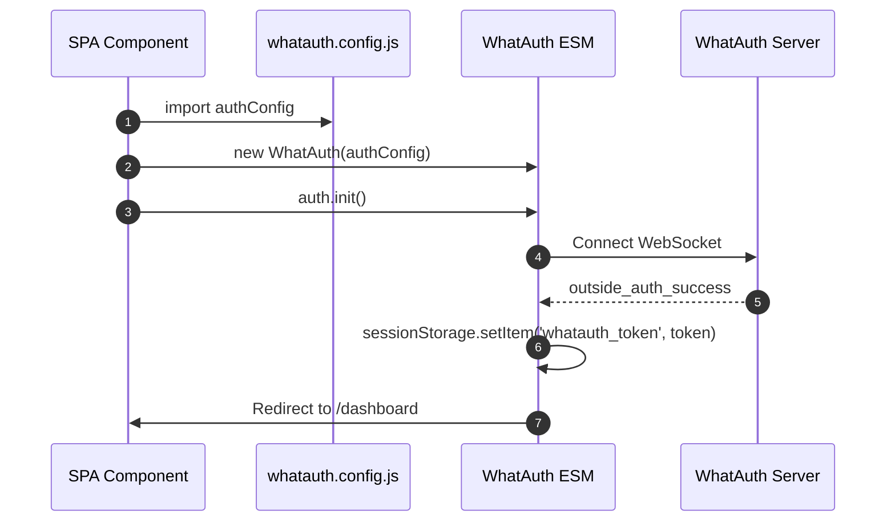
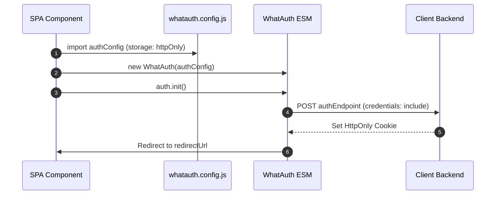

# WhatAuth ESM SDK

Guide d'intégration du SDK ES Module de WhatAuth pour frameworks modernes (React, Vue, Angular, Svelte, Next.js) et navigateurs avec support natif des modules ES.

---

## Prérequis

1. S'inscrire sur whatauth.com
2. Avoir une licence active
3. Dans la section LoginQR: personnaliser le QR avec domaine, phrase, emojis et Secret JWT
4. Créer une ApiKey publique dans la section API

---

## 1. Import Direct via CDN (Modules ES)

Le module exporte la classe `WhatAuth` instanciée et gérée via des événements réactifs.

### Mode sessionStorage

Enregistre automatiquement le jeton JWT dans le sessionStorage du navigateur (`whatauth_token`) et redirige l'utilisateur.

```javascript
import { WhatAuth } from 'https://cdn.whatauth.com/v1.0.0/whatauth.esm.js';

const auth = new WhatAuth({
  apiKey: 'wk_live_create_in_dashboard_apikey',
  wsUrl: 'https://api.whatauth.com',
  storage: 'sessionStorage',
  redirectUrl: '/dashboard',
  domain: window.location.host
});

auth.on('connected', (data) => {
  console.log('Socket connected:', data.socketId);
});

auth.on('success', (data) => {
  console.log('Authentication successful:', data.phone);
});

auth.on('error', (err) => {
  console.error('Authentication error:', err);
});

auth.init();
```



### Mode httpOnly

Transmet le jeton via une requête POST avec informations d'authentification à votre backend pour définir des cookies sécurisés HttpOnly.

```javascript
import { WhatAuth } from 'https://cdn.whatauth.com/v1.0.0/whatauth.esm.js';

const auth = new WhatAuth({
  apiKey: 'wk_live_create_in_dashboard_apikey',
  wsUrl: 'https://api.whatauth.com',
  storage: 'httpOnly',
  authEndpoint: '/api/auth/login',
  redirectUrl: '/dashboard',
  domain: window.location.host
});

auth.on('authEndpointSuccess', (data) => {
  console.log('Secure session cookie set:', data);
});

auth.on('authEndpointError', (err) => {
  console.error('Backend exchange error:', err);
});

auth.init();
```

```mermaid
sequenceDiagram
    autonumber
    participant App as SPA Component
    participant SDK as WhatAuth ESM
    participant API as Client Backend
    participant WS as WhatAuth Server
    App->>SDK: auth.init()
    SDK->>WS: Connect WebSocket
    WS-->>SDK: outside_auth_success (token, phone)
    SDK->>API: POST authEndpoint (token, credentials: include)
    API-->>SDK: 200 OK + Set-Cookie (HttpOnly; Secure)
    SDK->>App: Redirect to /dashboard
```

---

## 2. Fichier de Configuration whatauth.config.js

Sépare la configuration dans un module exportable réutilisable dans n'importe quel composant.

### Mode sessionStorage avec Config

```javascript
// whatauth.config.js
export const authConfig = {
  apiKey: 'wk_live_create_in_dashboard_apikey',
  wsUrl: 'https://api.whatauth.com',
  domain: window.location.host,
  storage: 'sessionStorage',
  redirectUrl: '/dashboard'
};
```

```javascript
import { WhatAuth } from 'https://cdn.whatauth.com/v1.0.0/whatauth.esm.js';
import { authConfig } from './whatauth.config.js';

const auth = new WhatAuth(authConfig);
auth.init();
```



### Mode httpOnly avec Config

```javascript
// whatauth.config.js
export const authConfig = {
  apiKey: 'wk_live_create_in_dashboard_apikey',
  wsUrl: 'https://api.whatauth.com',
  domain: window.location.host,
  storage: 'httpOnly',
  authEndpoint: '/api/auth/login',
  redirectUrl: '/dashboard'
};
```

```javascript
import { WhatAuth } from 'https://cdn.whatauth.com/v1.0.0/whatauth.esm.js';
import { authConfig } from './whatauth.config.js';

const auth = new WhatAuth(authConfig);
auth.init();
```



---

## 3. Matrice des Options de Configuration

| Propriété | Type | Description |
|---|---|---|
| `apiKey` | `String` | Clé API publique générée sur le panneau (wk_live_create_in_dashboard_apikey). Obligatoire. |
| `wsUrl` | `String` | Serveur WebSocket (https://api.whatauth.com). |
| `domain` | `String` | Domaine autorisé. Défaut: window.location.host. |
| `storage` | `String` | Mode de session: "sessionStorage" ou "httpOnly". |
| `redirectUrl` | `String` | URL de redirection automatique après validation. |
| `authEndpoint` | `String` | Point de terminaison POST requis uniquement en mode "httpOnly". |
| `qrId` | `String` | ID du conteneur ou image pour le QR (déf: "whatauth-qr"). |
| `linkId` | `String` | ID du bouton/lien WhatsApp (déf: "whatauth-link"). |
| `expiredId` | `String` | ID du conteneur d'expiration (déf: "whatauth-expired"). |
| `statusId` | `String` | ID du conteneur d'état (déf: "whatauth-status"). |
| `pinId` | `String` | ID du conteneur du PIN numérique (déf: "whatauth-pin"). |
| `sessionDuration` | `Number` | Durée d'expiration de session en secondes (déf: 300). |
