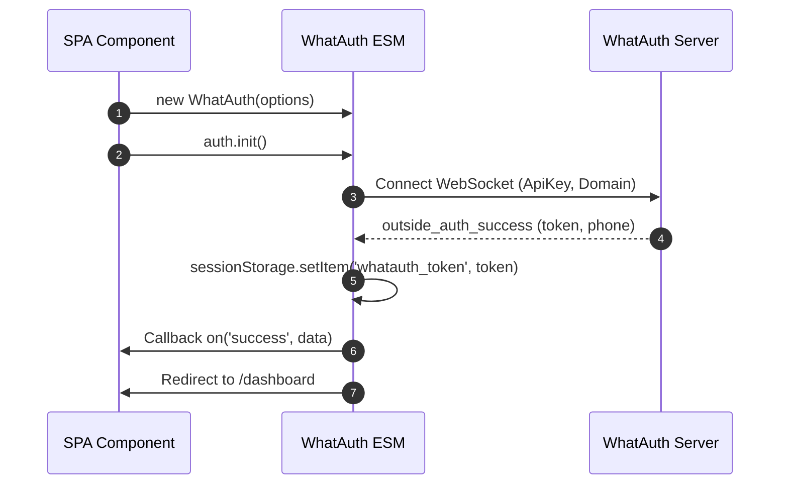
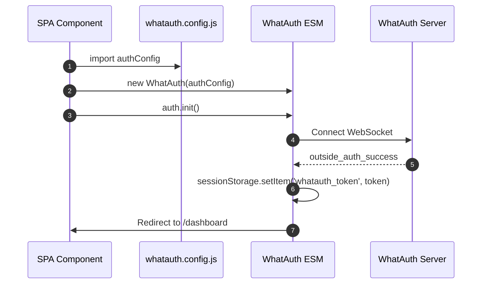
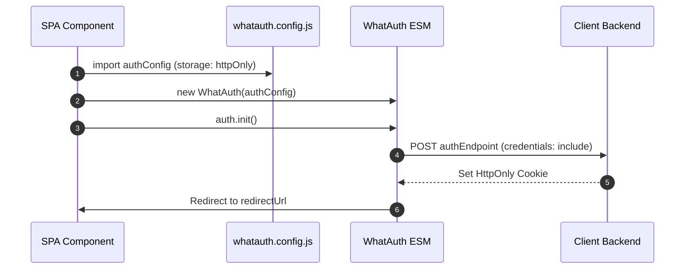

# WhatAuth ESM SDK

आधुनिक फ्रेमवर्क (React, Vue, Angular, Svelte, Next.js) और ब्राउज़र मॉड्यूल के लिए WhatAuth ES Module SDK एकीकरण गाइड।

---

## पूर्वापेक्षाएँ (Prerequisites)

1. whatauth.com पर पंजीकरण करें
2. एक सक्रिय लाइसेंस योजना रखें
3. LoginQR अनुभाग में: डोमेन, वाक्यांश, इमोजी और JWT Secret के साथ QR अनुकूलित करें
4. API अनुभाग में एक सार्वजनिक ApiKey बनाएँ

---

## 1. CDN डायरेक्ट इंपोर्ट (ES Modules)

मॉड्यूल `WhatAuth` क्लास निर्यात करता है, जिसे प्रतिक्रियाशील घटनाओं के माध्यम से प्रबंधित किया जाता है।

### sessionStorage मोड

ब्राउज़र sessionStorage (`whatauth_token`) में स्वचालित रूप से JWT टोकन संग्रहीत करता है और उपयोगकर्ता को पुनर्निर्देशित करता है।

```javascript
import { WhatAuth } from 'https://cdn.whatauth.com/v1.0.0/whatauth.esm.js';

const auth = new WhatAuth({
  apiKey: 'wk_live_create_in_dashboard_apikey',
  wsUrl: 'https://api.whatauth.com',
  storage: 'sessionStorage',
  redirectUrl: '/dashboard',
  domain: window.location.host
});

auth.on('connected', (data) => {
  console.log('Socket connected:', data.socketId);
});

auth.on('success', (data) => {
  console.log('Authentication successful:', data.phone);
});

auth.on('error', (err) => {
  console.error('Authentication error:', err);
});

auth.init();
```



### httpOnly मोड

सुरक्षित HttpOnly कुकीज़ सेट करने के लिए क्रेडेंशियल्स के साथ बैकएंड पर POST अनुरोध के माध्यम से टोकन भेजता है।

```javascript
import { WhatAuth } from 'https://cdn.whatauth.com/v1.0.0/whatauth.esm.js';

const auth = new WhatAuth({
  apiKey: 'wk_live_create_in_dashboard_apikey',
  wsUrl: 'https://api.whatauth.com',
  storage: 'httpOnly',
  authEndpoint: '/api/auth/login',
  redirectUrl: '/dashboard',
  domain: window.location.host
});

auth.on('authEndpointSuccess', (data) => {
  console.log('Secure session cookie set:', data);
});

auth.on('authEndpointError', (err) => {
  console.error('Backend exchange error:', err);
});

auth.init();
```

```mermaid
sequenceDiagram
    autonumber
    participant App as SPA Component
    participant SDK as WhatAuth ESM
    participant API as Client Backend
    participant WS as WhatAuth Server
    App->>SDK: auth.init()
    SDK->>WS: Connect WebSocket
    WS-->>SDK: outside_auth_success (token, phone)
    SDK->>API: POST authEndpoint (token, credentials: include)
    API-->>SDK: 200 OK + Set-Cookie (HttpOnly; Secure)
    SDK->>App: Redirect to /dashboard
```

---

## 2. कॉन्फ़िगरेशन फ़ाइल whatauth.config.js

कॉन्फ़िगरेशन को किसी भी घटक में पुन: प्रयोज्य निर्यात करने योग्य मॉड्यूल में अलग करता है।

### Config के साथ sessionStorage मोड

```javascript
// whatauth.config.js
export const authConfig = {
  apiKey: 'wk_live_create_in_dashboard_apikey',
  wsUrl: 'https://api.whatauth.com',
  domain: window.location.host,
  storage: 'sessionStorage',
  redirectUrl: '/dashboard'
};
```

```javascript
import { WhatAuth } from 'https://cdn.whatauth.com/v1.0.0/whatauth.esm.js';
import { authConfig } from './whatauth.config.js';

const auth = new WhatAuth(authConfig);
auth.init();
```



### Config के साथ httpOnly मोड

```javascript
// whatauth.config.js
export const authConfig = {
  apiKey: 'wk_live_create_in_dashboard_apikey',
  wsUrl: 'https://api.whatauth.com',
  domain: window.location.host,
  storage: 'httpOnly',
  authEndpoint: '/api/auth/login',
  redirectUrl: '/dashboard'
};
```

```javascript
import { WhatAuth } from 'https://cdn.whatauth.com/v1.0.0/whatauth.esm.js';
import { authConfig } from './whatauth.config.js';

const auth = new WhatAuth(authConfig);
auth.init();
```



---

## 3. कॉन्फ़िगरेशन विकल्प तालिका

| प्रॉपर्टी | प्रकार | विवरण |
|---|---|---|
| `apiKey` | `String` | कंसोल में उत्पन्न सार्वजनिक एपीआई कुंजी (wk_live_create_in_dashboard_apikey). आवश्यक। |
| `wsUrl` | `String` | WebSocket सर्वर (https://api.whatauth.com)। |
| `domain` | `String` | अधिकृत डोमेन। डिफ़ॉल्ट: window.location.host। |
| `storage` | `String` | सत्र मोड: "sessionStorage" या "httpOnly"। |
| `redirectUrl` | `String` | सफल प्रमाणीकरण के बाद स्वचालित नेविगेशन पथ। |
| `authEndpoint` | `String` | केवल "httpOnly" मोड में आवश्यक POST एंडपॉइंट। |
| `qrId` | `String` | क्यूआर कोड कंटेनर या छवि आईडी (डिफ़ॉल्ट: "whatauth-qr")। |
| `linkId` | `String` | व्हाट्सएप बटन/लिंक आईडी (डिफ़ॉल्ट: "whatauth-link")। |
| `expiredId` | `String` | समाप्ति संदेश कंटेनर आईडी (डिफ़ॉल्ट: "whatauth-expired")। |
| `statusId` | `String` | स्थिति संदेश कंटेनर आईडी (डिफ़ॉल्ट: "whatauth-status")। |
| `pinId` | `String` | संख्यात्मक पिन कंटेनर आईडी (डिफ़ॉल्ट: "whatauth-pin")। |
| `sessionDuration` | `Number` | सत्र समाप्ति समय सेकंड में (डिफ़ॉल्ट: 300)। |
