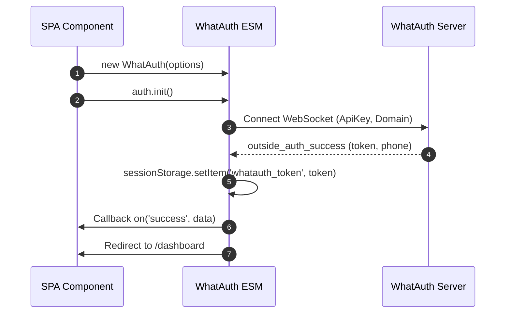
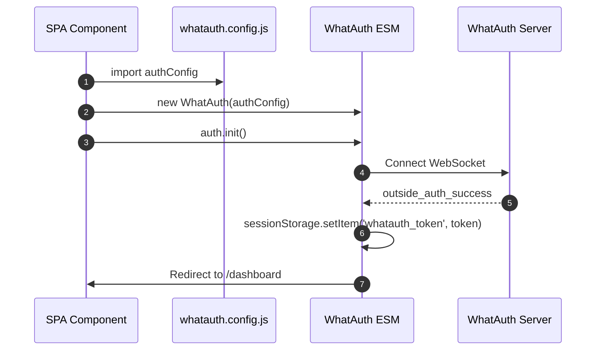
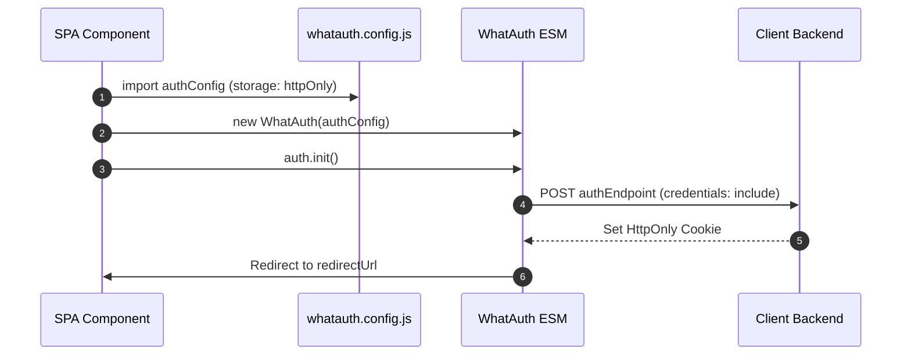

# WhatAuth ESM SDK

Guida all'integrazione dell'SDK ES Module di WhatAuth per framework moderni (React, Vue, Angular, Svelte, Next.js) e browser con supporto nativo dei moduli ES.

---

## Prerequisiti

1. Registrarsi su whatauth.com
2. Avere una licenza attiva
3. Nella sezione LoginQR: personalizzare il QR con dominio, frase, emoji e Secret JWT
4. Creare un'ApiKey pubblica nella sezione API

---

## 1. Importazione Diretta tramite CDN (Moduli ES)

Il modulo esporta la classe `WhatAuth`, gestita tramite ciclo di vita ed eventi reattivi.

### Modalità sessionStorage

Salva automaticamente il token JWT nel sessionStorage del browser (`whatauth_token`) e reindirizza l'utente.

```javascript
import { WhatAuth } from 'https://cdn.whatauth.com/v1.0.0/whatauth.esm.js';

const auth = new WhatAuth({
  apiKey: 'wk_live_create_in_dashboard_apikey',
  wsUrl: 'https://api.whatauth.com',
  storage: 'sessionStorage',
  redirectUrl: '/dashboard',
  domain: window.location.host
});

auth.on('connected', (data) => {
  console.log('Socket connected:', data.socketId);
});

auth.on('success', (data) => {
  console.log('Authentication successful:', data.phone);
});

auth.on('error', (err) => {
  console.error('Authentication error:', err);
});

auth.init();
```



### Modalità httpOnly

Invia il token tramite richiesta POST con credenziali al backend per impostare cookie sicuri HttpOnly.

```javascript
import { WhatAuth } from 'https://cdn.whatauth.com/v1.0.0/whatauth.esm.js';

const auth = new WhatAuth({
  apiKey: 'wk_live_create_in_dashboard_apikey',
  wsUrl: 'https://api.whatauth.com',
  storage: 'httpOnly',
  authEndpoint: '/api/auth/login',
  redirectUrl: '/dashboard',
  domain: window.location.host
});

auth.on('authEndpointSuccess', (data) => {
  console.log('Secure session cookie set:', data);
});

auth.on('authEndpointError', (err) => {
  console.error('Backend exchange error:', err);
});

auth.init();
```

```mermaid
sequenceDiagram
    autonumber
    participant App as SPA Component
    participant SDK as WhatAuth ESM
    participant API as Client Backend
    participant WS as WhatAuth Server
    App->>SDK: auth.init()
    SDK->>WS: Connect WebSocket
    WS-->>SDK: outside_auth_success (token, phone)
    SDK->>API: POST authEndpoint (token, credentials: include)
    API-->>SDK: 200 OK + Set-Cookie (HttpOnly; Secure)
    SDK->>App: Redirect to /dashboard
```

---

## 2. File di Configurazione whatauth.config.js

Disaccoppia le opzioni in un modulo esportabile riutilizzabile in qualsiasi componente.

### Modalità sessionStorage con Config

```javascript
// whatauth.config.js
export const authConfig = {
  apiKey: 'wk_live_create_in_dashboard_apikey',
  wsUrl: 'https://api.whatauth.com',
  domain: window.location.host,
  storage: 'sessionStorage',
  redirectUrl: '/dashboard'
};
```

```javascript
import { WhatAuth } from 'https://cdn.whatauth.com/v1.0.0/whatauth.esm.js';
import { authConfig } from './whatauth.config.js';

const auth = new WhatAuth(authConfig);
auth.init();
```



### Modalità httpOnly con Config

```javascript
// whatauth.config.js
export const authConfig = {
  apiKey: 'wk_live_create_in_dashboard_apikey',
  wsUrl: 'https://api.whatauth.com',
  domain: window.location.host,
  storage: 'httpOnly',
  authEndpoint: '/api/auth/login',
  redirectUrl: '/dashboard'
};
```

```javascript
import { WhatAuth } from 'https://cdn.whatauth.com/v1.0.0/whatauth.esm.js';
import { authConfig } from './whatauth.config.js';

const auth = new WhatAuth(authConfig);
auth.init();
```



---

## 3. Matrice delle Opzioni di Configurazione

| Proprietà | Tipo | Descrizione |
|---|---|---|
| `apiKey` | `String` | Chiave API pubblica generata nel pannello (wk_live_create_in_dashboard_apikey). Obbligatorio. |
| `wsUrl` | `String` | Server WebSocket (https://api.whatauth.com). |
| `domain` | `String` | Dominio autorizzato. Predefinito: window.location.host. |
| `storage` | `String` | Modalità sessione: "sessionStorage" o "httpOnly". |
| `redirectUrl` | `String` | Percorso di navigazione automatica dopo la convalida. |
| `authEndpoint` | `String` | Endpoint POST richiesto solo in modalità "httpOnly". |
| `qrId` | `String` | ID del contenitore o immagine per il QR (def: "whatauth-qr"). |
| `linkId` | `String` | ID del pulsante/link per WhatsApp (def: "whatauth-link"). |
| `expiredId` | `String` | ID del messaggio di scadenza (def: "whatauth-expired"). |
| `statusId` | `String` | ID del contenitore di stato (def: "whatauth-status"). |
| `pinId` | `String` | ID del contenitore PIN numerico (def: "whatauth-pin"). |
| `sessionDuration` | `Number` | Tempo di scadenza della sessione in secondi (def: 300). |
