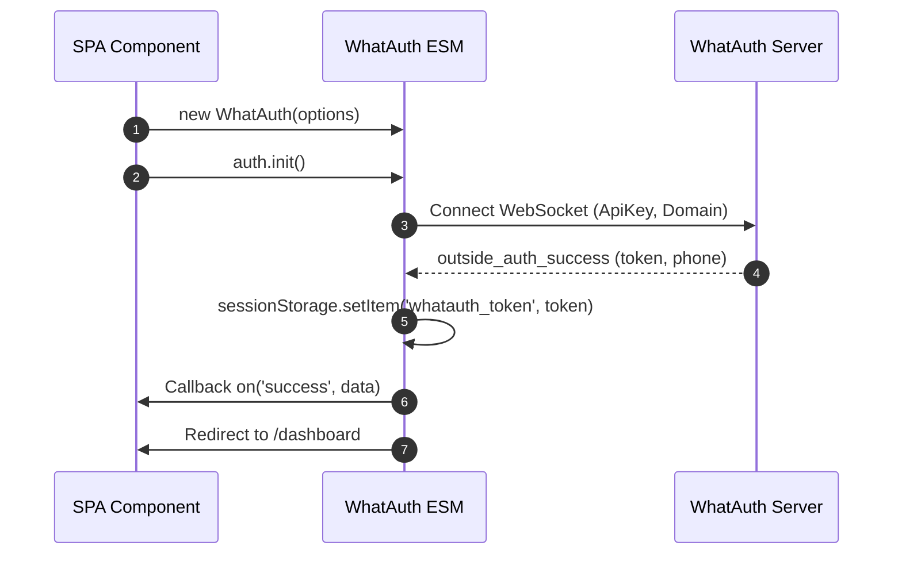
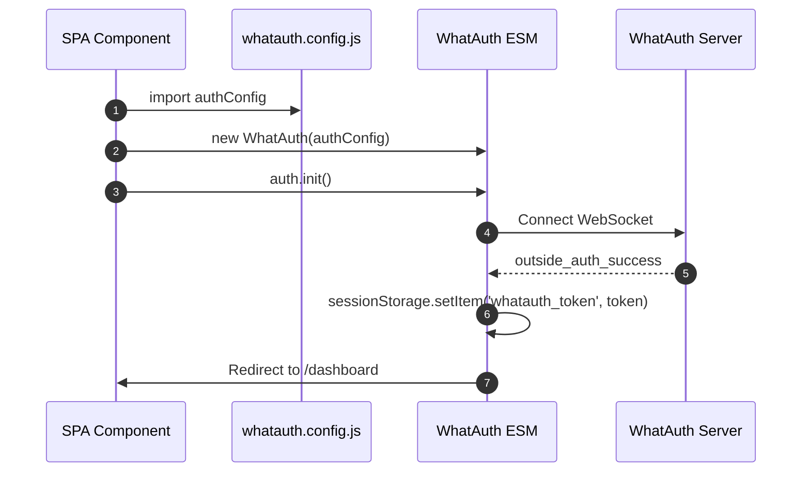
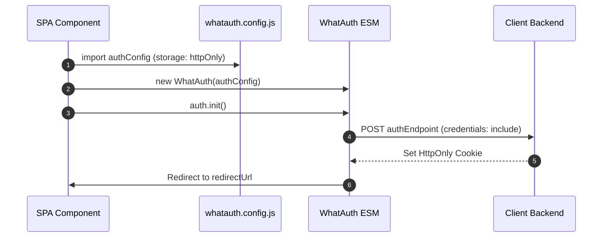

# WhatAuth ESM SDK

モダンフレームワーク (React, Vue, Angular, Svelte, Next.js) およびブラウザ標準 ES モジュール向け WhatAuth ESM SDK 導入ガイド。

---

## 事前準備 (前提条件)

1. whatauth.com でアカウント登録を行う
2. 有効なライセンスプランを契約していること
3. LoginQR セクションでドメイン、フレーズ、絵文字、JWT Secret を設定する
4. API セクションで公開 ApiKey を作成する

---

## 1. CDN 直接インポート (ES Modules)

本モジュールは `WhatAuth` クラスをエクスポートし、イベント駆動型で動作します。

### sessionStorage モード

ブラウザの sessionStorage (`whatauth_token`) に JWT トークンを自動保存し、リダイレクトを実行します。

```javascript
import { WhatAuth } from 'https://cdn.whatauth.com/v1.0.0/whatauth.esm.js';

const auth = new WhatAuth({
  apiKey: 'wk_live_create_in_dashboard_apikey',
  wsUrl: 'https://api.whatauth.com',
  storage: 'sessionStorage',
  redirectUrl: '/dashboard',
  domain: window.location.host
});

auth.on('connected', (data) => {
  console.log('Socket connected:', data.socketId);
});

auth.on('success', (data) => {
  console.log('Authentication successful:', data.phone);
});

auth.on('error', (err) => {
  console.error('Authentication error:', err);
});

auth.init();
```



### httpOnly モード

安全な HttpOnly Cookie を設定するため、認証情報を付加した POST リクエストでバックエンドにトークンを送信します。

```javascript
import { WhatAuth } from 'https://cdn.whatauth.com/v1.0.0/whatauth.esm.js';

const auth = new WhatAuth({
  apiKey: 'wk_live_create_in_dashboard_apikey',
  wsUrl: 'https://api.whatauth.com',
  storage: 'httpOnly',
  authEndpoint: '/api/auth/login',
  redirectUrl: '/dashboard',
  domain: window.location.host
});

auth.on('authEndpointSuccess', (data) => {
  console.log('Secure session cookie set:', data);
});

auth.on('authEndpointError', (err) => {
  console.error('Backend exchange error:', err);
});

auth.init();
```

```mermaid
sequenceDiagram
    autonumber
    participant App as SPA Component
    participant SDK as WhatAuth ESM
    participant API as Client Backend
    participant WS as WhatAuth Server
    App->>SDK: auth.init()
    SDK->>WS: Connect WebSocket
    WS-->>SDK: outside_auth_success (token, phone)
    SDK->>API: POST authEndpoint (token, credentials: include)
    API-->>SDK: 200 OK + Set-Cookie (HttpOnly; Secure)
    SDK->>App: Redirect to /dashboard
```

---

## 2. 外部設定ファイル whatauth.config.js

設定を別モジュールに分離し、任意のコンポーネントで再利用できます。

### Config を使用した sessionStorage モード

```javascript
// whatauth.config.js
export const authConfig = {
  apiKey: 'wk_live_create_in_dashboard_apikey',
  wsUrl: 'https://api.whatauth.com',
  domain: window.location.host,
  storage: 'sessionStorage',
  redirectUrl: '/dashboard'
};
```

```javascript
import { WhatAuth } from 'https://cdn.whatauth.com/v1.0.0/whatauth.esm.js';
import { authConfig } from './whatauth.config.js';

const auth = new WhatAuth(authConfig);
auth.init();
```



### Config を使用した httpOnly モード

```javascript
// whatauth.config.js
export const authConfig = {
  apiKey: 'wk_live_create_in_dashboard_apikey',
  wsUrl: 'https://api.whatauth.com',
  domain: window.location.host,
  storage: 'httpOnly',
  authEndpoint: '/api/auth/login',
  redirectUrl: '/dashboard'
};
```

```javascript
import { WhatAuth } from 'https://cdn.whatauth.com/v1.0.0/whatauth.esm.js';
import { authConfig } from './whatauth.config.js';

const auth = new WhatAuth(authConfig);
auth.init();
```



---

## 3. 設定オプション対応表

| プロパティ | 型 | 説明 |
|---|---|---|
| `apiKey` | `String` | 管理画面で発行された公開 API キー (wk_live_create_in_dashboard_apikey)。必須。 |
| `wsUrl` | `String` | WebSocket サーバー URL (https://api.whatauth.com)。 |
| `domain` | `String` | 認証済みドメイン。デフォルト: window.location.host。 |
| `storage` | `String` | 保存モード: "sessionStorage" または "httpOnly"。 |
| `redirectUrl` | `String` | 認証成功後の自動リダイレクト先 URL。 |
| `authEndpoint` | `String` | httpOnly モード時に必須となるバックエンド POST エンドポイント。 |
| `qrId` | `String` | QR コード表示用コンテナまたは画像の ID (デフォルト: "whatauth-qr")。 |
| `linkId` | `String` | WhatsApp 起動ボタン/リンクの ID (デフォルト: "whatauth-link")。 |
| `expiredId` | `String` | 有効期限切れメッセージの ID (デフォルト: "whatauth-expired")。 |
| `statusId` | `String` | 接続状態表示用コンテナの ID (デフォルト: "whatauth-status")。 |
| `pinId` | `String` | 4桁の検証用 PIN コード表示コンテナ ID (デフォルト: "whatauth-pin")。 |
| `sessionDuration` | `Number` | セッション有効期限 (秒, デフォルト: 300)。 |
