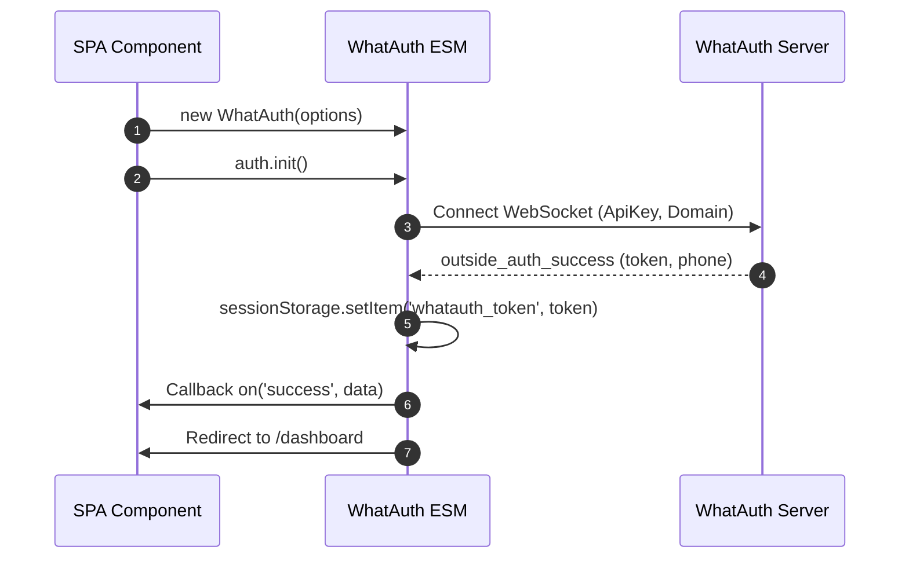
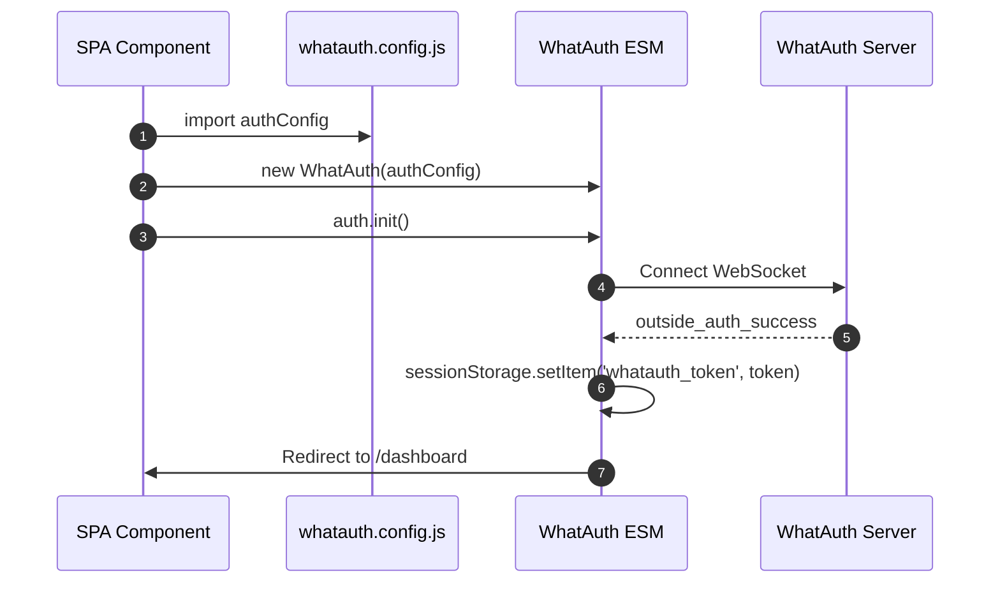
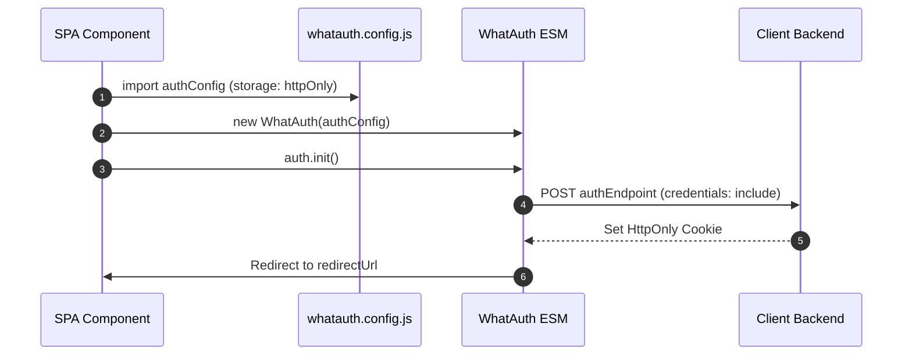

# WhatAuth ESM SDK

Guia de integração do SDK ES Module do WhatAuth para frameworks modernos (React, Vue, Angular, Svelte, Next.js) e navegadores com suporte nativo a módulos ES.

---

## Pré-requisitos

1. Registrar-se em whatauth.com
2. Possuir uma licença ativa
3. Na seção LoginQR: personalizar o QR com domínio, frase, emojis e Secret JWT
4. Criar uma ApiKey pública na seção API

---

## 1. Importação Direta via CDN (Módulos ES)

O módulo exporta a classe `WhatAuth`, instanciada e gerenciada por meio de eventos reativos.

### Modalidade sessionStorage

Salva automaticamente o token JWT no sessionStorage do navegador (`whatauth_token`) e redireciona o usuário.

```javascript
import { WhatAuth } from 'https://cdn.whatauth.com/v1.0.0/whatauth.esm.js';

const auth = new WhatAuth({
  apiKey: 'wk_live_create_in_dashboard_apikey',
  wsUrl: 'https://api.whatauth.com',
  storage: 'sessionStorage',
  redirectUrl: '/dashboard',
  domain: window.location.host
});

auth.on('connected', (data) => {
  console.log('Socket connected:', data.socketId);
});

auth.on('success', (data) => {
  console.log('Authentication successful:', data.phone);
});

auth.on('error', (err) => {
  console.error('Authentication error:', err);
});

auth.init();
```



### Modalidade httpOnly

Envia o token por meio de uma solicitação POST com credenciais ao seu backend para definir cookies HttpOnly seguros.

```javascript
import { WhatAuth } from 'https://cdn.whatauth.com/v1.0.0/whatauth.esm.js';

const auth = new WhatAuth({
  apiKey: 'wk_live_create_in_dashboard_apikey',
  wsUrl: 'https://api.whatauth.com',
  storage: 'httpOnly',
  authEndpoint: '/api/auth/login',
  redirectUrl: '/dashboard',
  domain: window.location.host
});

auth.on('authEndpointSuccess', (data) => {
  console.log('Secure session cookie set:', data);
});

auth.on('authEndpointError', (err) => {
  console.error('Backend exchange error:', err);
});

auth.init();
```

```mermaid
sequenceDiagram
    autonumber
    participant App as SPA Component
    participant SDK as WhatAuth ESM
    participant API as Client Backend
    participant WS as WhatAuth Server
    App->>SDK: auth.init()
    SDK->>WS: Connect WebSocket
    WS-->>SDK: outside_auth_success (token, phone)
    SDK->>API: POST authEndpoint (token, credentials: include)
    API-->>SDK: 200 OK + Set-Cookie (HttpOnly; Secure)
    SDK->>App: Redirect to /dashboard
```

---

## 2. Arquivo de Configuração whatauth.config.js

Desacopla as configurações em um módulo exportável reutilizável em qualquer componente.

### Modalidade sessionStorage com Config

```javascript
// whatauth.config.js
export const authConfig = {
  apiKey: 'wk_live_create_in_dashboard_apikey',
  wsUrl: 'https://api.whatauth.com',
  domain: window.location.host,
  storage: 'sessionStorage',
  redirectUrl: '/dashboard'
};
```

```javascript
import { WhatAuth } from 'https://cdn.whatauth.com/v1.0.0/whatauth.esm.js';
import { authConfig } from './whatauth.config.js';

const auth = new WhatAuth(authConfig);
auth.init();
```



### Modalidade httpOnly com Config

```javascript
// whatauth.config.js
export const authConfig = {
  apiKey: 'wk_live_create_in_dashboard_apikey',
  wsUrl: 'https://api.whatauth.com',
  domain: window.location.host,
  storage: 'httpOnly',
  authEndpoint: '/api/auth/login',
  redirectUrl: '/dashboard'
};
```

```javascript
import { WhatAuth } from 'https://cdn.whatauth.com/v1.0.0/whatauth.esm.js';
import { authConfig } from './whatauth.config.js';

const auth = new WhatAuth(authConfig);
auth.init();
```



---

## 3. Matriz de Opções de Configuração

| Propriedade | Tipo | Descrição |
|---|---|---|
| `apiKey` | `String` | Chave pública da API gerada no painel (wk_live_create_in_dashboard_apikey). Obrigatório. |
| `wsUrl` | `String` | Servidor WebSocket (https://api.whatauth.com). |
| `domain` | `String` | Domínio autorizado. Padrão: window.location.host. |
| `storage` | `String` | Modo de sessão: "sessionStorage" ou "httpOnly". |
| `redirectUrl` | `String` | Rota de navegação automática após validação bem-sucedida. |
| `authEndpoint` | `String` | Endpoint POST obrigatório apenas no modo "httpOnly". |
| `qrId` | `String` | ID do contêiner ou imagem do QR (padrão: "whatauth-qr"). |
| `linkId` | `String` | ID do botão/link do WhatsApp (padrão: "whatauth-link"). |
| `expiredId` | `String` | ID da mensagem de expiração (padrão: "whatauth-expired"). |
| `statusId` | `String` | ID do contêiner de status (padrão: "whatauth-status"). |
| `pinId` | `String` | ID do contêiner de PIN numérico (padrão: "whatauth-pin"). |
| `sessionDuration` | `Number` | Tempo de expiração da sessão em segundos (padrão: 300). |
