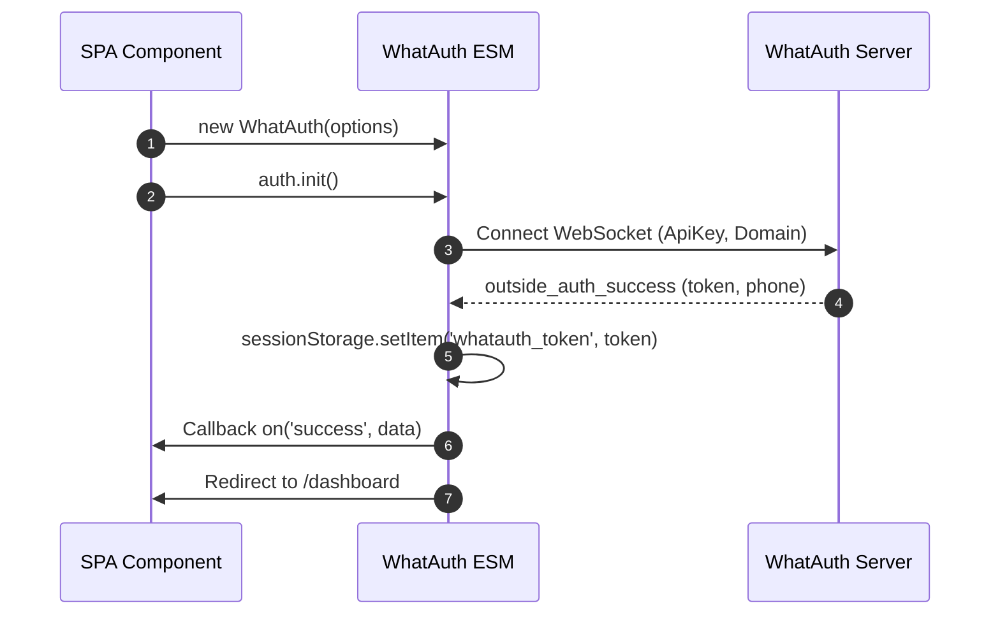
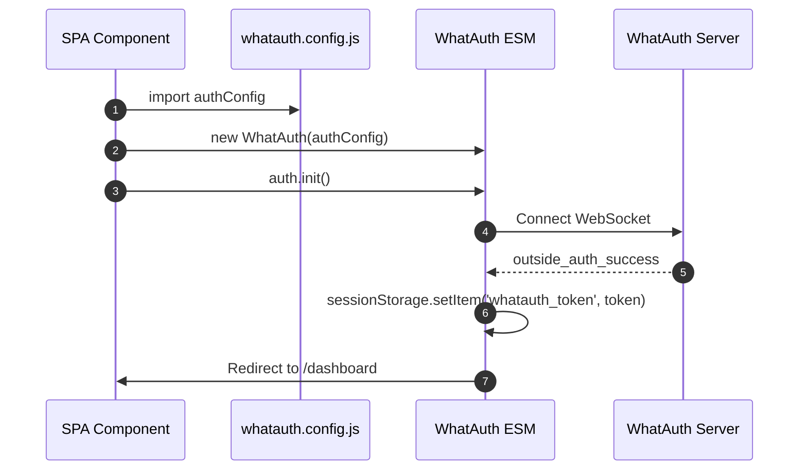
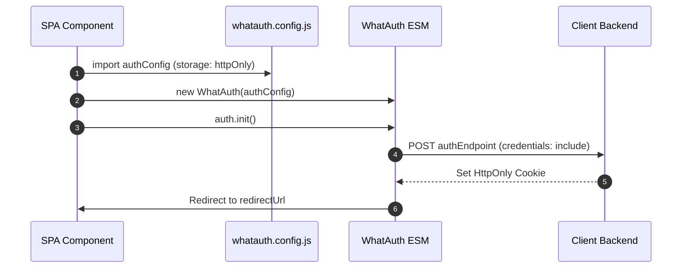

# WhatAuth ESM SDK

Руководство по интеграции WhatAuth ES Module SDK для современных фреймворков (React, Vue, Angular, Svelte, Next.js) и браузеров с нативной поддержкой ES-модулей.

---

## Предварительные требования

1. Зарегистрироваться на whatauth.com
2. Иметь активную лицензию
3. В разделе LoginQR: настроить QR-код с доменом, фразой, эмодзи и JWT Secret
4. Создать публичный ApiKey в разделе API

---

## 1. Прямой импорт через CDN (ES Modules)

Модуль экспортирует класс `WhatAuth`, управляемый реактивными событиями.

### Режим sessionStorage

Автоматически сохраняет токен JWT в sessionStorage браузера (`whatauth_token`) и перенаправляет пользователя.

```javascript
import { WhatAuth } from 'https://cdn.whatauth.com/v1.0.0/whatauth.esm.js';

const auth = new WhatAuth({
  apiKey: 'wk_live_create_in_dashboard_apikey',
  wsUrl: 'https://api.whatauth.com',
  storage: 'sessionStorage',
  redirectUrl: '/dashboard',
  domain: window.location.host
});

auth.on('connected', (data) => {
  console.log('Socket connected:', data.socketId);
});

auth.on('success', (data) => {
  console.log('Authentication successful:', data.phone);
});

auth.on('error', (err) => {
  console.error('Authentication error:', err);
});

auth.init();
```



### Режим httpOnly

Отправляет токен через POST-запрос с учетными данными на ваш бэкенд для установки защищенных файлов cookie HttpOnly.

```javascript
import { WhatAuth } from 'https://cdn.whatauth.com/v1.0.0/whatauth.esm.js';

const auth = new WhatAuth({
  apiKey: 'wk_live_create_in_dashboard_apikey',
  wsUrl: 'https://api.whatauth.com',
  storage: 'httpOnly',
  authEndpoint: '/api/auth/login',
  redirectUrl: '/dashboard',
  domain: window.location.host
});

auth.on('authEndpointSuccess', (data) => {
  console.log('Secure session cookie set:', data);
});

auth.on('authEndpointError', (err) => {
  console.error('Backend exchange error:', err);
});

auth.init();
```

```mermaid
sequenceDiagram
    autonumber
    participant App as SPA Component
    participant SDK as WhatAuth ESM
    participant API as Client Backend
    participant WS as WhatAuth Server
    App->>SDK: auth.init()
    SDK->>WS: Connect WebSocket
    WS-->>SDK: outside_auth_success (token, phone)
    SDK->>API: POST authEndpoint (token, credentials: include)
    API-->>SDK: 200 OK + Set-Cookie (HttpOnly; Secure)
    SDK->>App: Redirect to /dashboard
```

---

## 2. Файл конфигурации whatauth.config.js

Выносит параметры в экспортируемый модуль для повторного использования в любом компоненте.

### Режим sessionStorage с Config

```javascript
// whatauth.config.js
export const authConfig = {
  apiKey: 'wk_live_create_in_dashboard_apikey',
  wsUrl: 'https://api.whatauth.com',
  domain: window.location.host,
  storage: 'sessionStorage',
  redirectUrl: '/dashboard'
};
```

```javascript
import { WhatAuth } from 'https://cdn.whatauth.com/v1.0.0/whatauth.esm.js';
import { authConfig } from './whatauth.config.js';

const auth = new WhatAuth(authConfig);
auth.init();
```



### Режим httpOnly с Config

```javascript
// whatauth.config.js
export const authConfig = {
  apiKey: 'wk_live_create_in_dashboard_apikey',
  wsUrl: 'https://api.whatauth.com',
  domain: window.location.host,
  storage: 'httpOnly',
  authEndpoint: '/api/auth/login',
  redirectUrl: '/dashboard'
};
```

```javascript
import { WhatAuth } from 'https://cdn.whatauth.com/v1.0.0/whatauth.esm.js';
import { authConfig } from './whatauth.config.js';

const auth = new WhatAuth(authConfig);
auth.init();
```



---

## 3. Таблица параметров конфигурации

| Свойство | Тип | Описание |
|---|---|---|
| `apiKey` | `String` | Публичный API-ключ из панели управления (wk_live_create_in_dashboard_apikey). Обязательно. |
| `wsUrl` | `String` | Сервер WebSocket (https://api.whatauth.com). |
| `domain` | `String` | Авторизованный домен. По умолчанию: window.location.host. |
| `storage` | `String` | Режим сессии: "sessionStorage" или "httpOnly". |
| `redirectUrl` | `String` | Путь автоматического перенаправления после успешного входа. |
| `authEndpoint` | `String` | POST-эндпоинт, требуемый исключительно в режиме "httpOnly". |
| `qrId` | `String` | ID контейнера или изображения QR (по умолч.: "whatauth-qr"). |
| `linkId` | `String` | ID кнопки/ссылки WhatsApp (по умолч.: "whatauth-link"). |
| `expiredId` | `String` | ID блока истекшей сессии (по умолч.: "whatauth-expired"). |
| `statusId` | `String` | ID контейнера статуса (по умолч.: "whatauth-status"). |
| `pinId` | `String` | ID контейнера цифрового PIN-кода (по умолч.: "whatauth-pin"). |
| `sessionDuration` | `Number` | Время жизни сессии в секундах (по умолч.: 300). |
