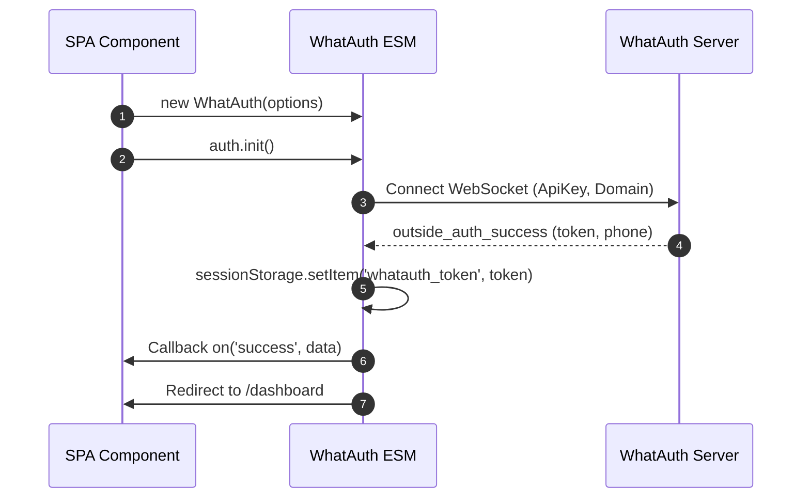
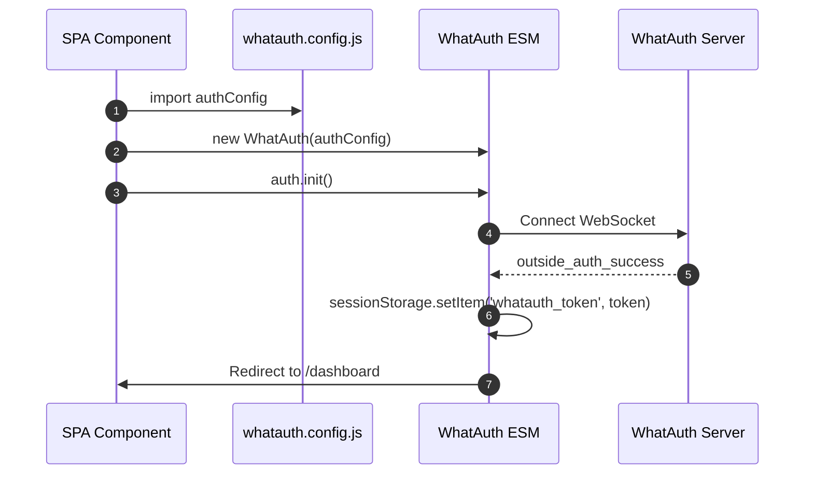
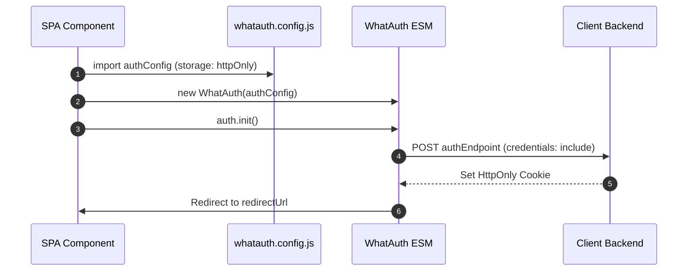

# WhatAuth ESM SDK

WhatAuth ES 模块客户端 SDK 集成指南，适用于现代前端框架 (React, Vue, Angular, Svelte, Next.js) 及原生 ES Module 浏览器环境。

---

## 前置准备要求

1. 在 whatauth.com 注册账号
2. 拥有有效的授权许可证
3. 在 LoginQR 模块: 自定义绑定域名、提示词、表情符号及 JWT Secret 密钥
4. 在 API 模块: 创建公钥 ApiKey

---

## 1. CDN 直接导入 (ES Modules)

该模块导出 `WhatAuth` 类，通过标准实例生命周期和响应式事件驱动。

### sessionStorage 模式

自动将已签名的 JWT 凭证存储至浏览器 sessionStorage (`whatauth_token`) 并执行可选跳转。

```javascript
import { WhatAuth } from 'https://cdn.whatauth.com/v1.0.0/whatauth.esm.js';

const auth = new WhatAuth({
  apiKey: 'wk_live_create_in_dashboard_apikey',
  wsUrl: 'https://api.whatauth.com',
  storage: 'sessionStorage',
  redirectUrl: '/dashboard',
  domain: window.location.host
});

auth.on('connected', (data) => {
  console.log('Socket connected:', data.socketId);
});

auth.on('success', (data) => {
  console.log('Authentication successful:', data.phone);
});

auth.on('error', (err) => {
  console.error('Authentication error:', err);
});

auth.init();
```



### httpOnly 模式

通过携带凭证的 POST 请求将 Token 发送至后端服务，以设置安全的 HttpOnly Cookie。

```javascript
import { WhatAuth } from 'https://cdn.whatauth.com/v1.0.0/whatauth.esm.js';

const auth = new WhatAuth({
  apiKey: 'wk_live_create_in_dashboard_apikey',
  wsUrl: 'https://api.whatauth.com',
  storage: 'httpOnly',
  authEndpoint: '/api/auth/login',
  redirectUrl: '/dashboard',
  domain: window.location.host
});

auth.on('authEndpointSuccess', (data) => {
  console.log('Secure session cookie set:', data);
});

auth.on('authEndpointError', (err) => {
  console.error('Backend exchange error:', err);
});

auth.init();
```

```mermaid
sequenceDiagram
    autonumber
    participant App as SPA Component
    participant SDK as WhatAuth ESM
    participant API as Client Backend
    participant WS as WhatAuth Server
    App->>SDK: auth.init()
    SDK->>WS: Connect WebSocket
    WS-->>SDK: outside_auth_success (token, phone)
    SDK->>API: POST authEndpoint (token, credentials: include)
    API-->>SDK: 200 OK + Set-Cookie (HttpOnly; Secure)
    SDK->>App: Redirect to /dashboard
```

---

## 2. 外部配置文件 whatauth.config.js

将配置解耦到可复用的独立 ES 模块中，方便在任何组件中导入。

### 通过 Config 使用 sessionStorage 模式

```javascript
// whatauth.config.js
export const authConfig = {
  apiKey: 'wk_live_create_in_dashboard_apikey',
  wsUrl: 'https://api.whatauth.com',
  domain: window.location.host,
  storage: 'sessionStorage',
  redirectUrl: '/dashboard'
};
```

```javascript
import { WhatAuth } from 'https://cdn.whatauth.com/v1.0.0/whatauth.esm.js';
import { authConfig } from './whatauth.config.js';

const auth = new WhatAuth(authConfig);
auth.init();
```



### 通过 Config 使用 httpOnly 模式

```javascript
// whatauth.config.js
export const authConfig = {
  apiKey: 'wk_live_create_in_dashboard_apikey',
  wsUrl: 'https://api.whatauth.com',
  domain: window.location.host,
  storage: 'httpOnly',
  authEndpoint: '/api/auth/login',
  redirectUrl: '/dashboard'
};
```

```javascript
import { WhatAuth } from 'https://cdn.whatauth.com/v1.0.0/whatauth.esm.js';
import { authConfig } from './whatauth.config.js';

const auth = new WhatAuth(authConfig);
auth.init();
```



---

## 3. 配置选项对照表

| 属性 | 类型 | 说明 |
|---|---|---|
| `apiKey` | `String` | 控制台生成的公钥 API Key (wk_live_create_in_dashboard_apikey)。必填。 |
| `wsUrl` | `String` | WebSocket 网关地址 (https://api.whatauth.com)。 |
| `domain` | `String` | 授权域名。默认为 window.location.host。 |
| `storage` | `String` | 存储模式: "sessionStorage" 或 "httpOnly"。 |
| `redirectUrl` | `String` | 扫码验证成功后的自动跳转目标路由。 |
| `authEndpoint` | `String` | httpOnly 模式下的后端接收 POST 路由。 |
| `qrId` | `String` | 展示二维码的图片或容器 ID (默认: "whatauth-qr")。 |
| `linkId` | `String` | WhatsApp 跳转按钮/链接 ID (默认: "whatauth-link")。 |
| `expiredId` | `String` | 过期提示遮罩层 ID (默认: "whatauth-expired")。 |
| `statusId` | `String` | 连接状态文本容器 ID (默认: "whatauth-status")。 |
| `pinId` | `String` | 4位数字验证 PIN 码容器 ID (默认: "whatauth-pin")。 |
| `sessionDuration` | `Number` | 二维码会话有效期 (秒, 默认: 300)。 |
