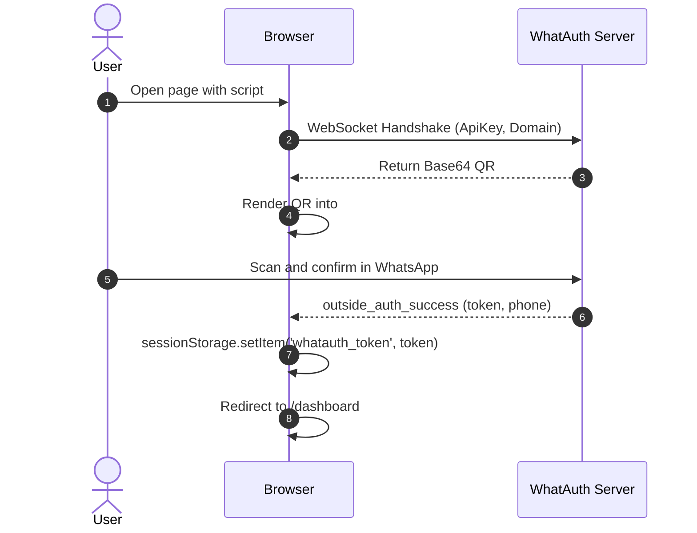
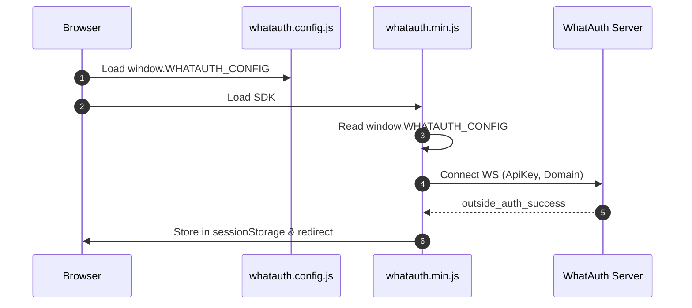
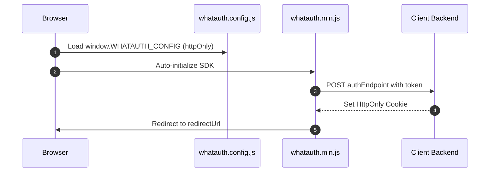

# WhatAuth CDN SDK

Integrationsleitfaden für das minifizierte WhatAuth CDN SDK (Vanilla JavaScript) über Script-Tag-Attribute oder globale Konfigurationsdatei.

---

## Voraussetzungen

1. Konto auf whatauth.com registrieren
2. Einen aktiven Lizenzplan besitzen
3. Im Bereich LoginQR: QR-Code mit Domäne, Text, Emojis und JWT-Secret anpassen
4. Einen öffentlichen ApiKey im Bereich API erstellen

---

## 1. Script-Attribute (Vanilla HTML)

Das `<script>`-Tag konfiguriert und initialisiert das SDK automatisch durch Auslesen der data-*-Attribute.

### sessionStorage-Modus

Speichert das JWT-Token im Sitzungsspeicher des Browsers und führt die optionale Weiterleitung durch.

```html
<!-- DOM Elements -->

<a id="whatauth-link">Login with WhatsApp</a>
<div id="whatauth-expired" style="display: none;">
  <span>Session Expired</span>
  <button onclick="location.reload()">Retry</button>
</div>
<div id="whatauth-status"></div>

<!-- WhatAuth CDN Script -->
<script 
  src="https://cdn.whatauth.com/v1.0.0/whatauth.min.js" 
  data-api-key="wk_live_YOUR_API_KEY"
  data-ws-url="https://api.whatauth.com"
  data-storage="sessionStorage"
  data-redirect-url="/dashboard"
  data-domain="yourdomain.com">
</script>
```



### httpOnly-Modus

Sendet das Token per POST-Anfrage mit Anmeldeinformationen an Ihr Backend, um sichere HttpOnly-Cookies zu setzen.

```html
<!-- DOM Elements -->

<a id="whatauth-link">Login with WhatsApp</a>
<div id="whatauth-expired" style="display: none;">
  <span>Session Expired</span>
  <button onclick="location.reload()">Retry</button>
</div>
<div id="whatauth-status"></div>

<!-- WhatAuth CDN Script (httpOnly mode) -->
<script 
  src="https://cdn.whatauth.com/v1.0.0/whatauth.min.js" 
  data-api-key="wk_live_YOUR_API_KEY"
  data-ws-url="https://api.whatauth.com"
  data-storage="httpOnly"
  data-auth-endpoint="/api/auth/login"
  data-redirect-url="/dashboard"
  data-domain="yourdomain.com">
</script>
```

```mermaid
sequenceDiagram
    autonumber
    actor U as User
    participant B as Browser
    participant S as Client Backend
    participant WS as WhatAuth Server
    B->>WS: Connect WS with ApiKey and Domain
    WS-->>B: Emit QR Code
    U->>WS: Scan via WhatsApp
    WS-->>B: outside_auth_success (token, phone)
    B->>S: POST /api/auth/login (token, credentials: include)
    S-->>B: Set-Cookie: session=...; HttpOnly; Secure
    B->>B: Redirect to /dashboard
```

---

## 2. Globale Datei whatauth.config.js

Auslagerung der Konfiguration in eine separate Datei. Das SDK führt diese Werte ohne Inline-Attribute im `<script>`-Tag zusammen.

### sessionStorage-Modus

```javascript
// whatauth.config.js
window.WHATAUTH_CONFIG = {
  apiKey: 'wk_live_YOUR_API_KEY',
  wsUrl: 'https://api.whatauth.com',
  domain: window.location.host,
  storage: 'sessionStorage',
  redirectUrl: '/dashboard'
};
```

```html
<!-- Load Config & CDN -->
<script src="./whatauth.config.js"></script>
<script src="https://cdn.whatauth.com/v1.0.0/whatauth.min.js"></script>
```



### httpOnly-Modus

```javascript
// whatauth.config.js
window.WHATAUTH_CONFIG = {
  apiKey: 'wk_live_YOUR_API_KEY',
  wsUrl: 'https://api.whatauth.com',
  domain: window.location.host,
  storage: 'httpOnly',
  authEndpoint: '/api/auth/login',
  redirectUrl: '/dashboard'
};
```

```html
<!-- Load Config & CDN -->
<script src="./whatauth.config.js"></script>
<script src="https://cdn.whatauth.com/v1.0.0/whatauth.min.js"></script>
```



---

## 3. Parameter- und Entsprechungsmatrix

| Script-Parameter | Config-Eigenschaft | Beschreibung |
|---|---|---|
| `data-api-key` | `apiKey` | Öffentlicher API-Schlüssel aus dem Dashboard (wk_live_...). Erforderlich. |
| `data-ws-url` | `wsUrl` | WebSocket-Serveradresse (https://api.whatauth.com). |
| `data-domain` | `domain` | Autorisierte Domäne. Standard: window.location.host. |
| `data-storage` | `storage` | Sitzungsmodus: sessionStorage oder httpOnly. |
| `data-redirect-url` | `redirectUrl` | Automatische Weiterleitungsroute nach erfolgreicher Prüfung. |
| `data-auth-endpoint` | `authEndpoint` | POST-Endpunkt, ausschließlich im httpOnly-Modus erforderlich. |
| `data-qr-id` | `qrId` | DOM-ID für den QR-Container/Bild (Standard: whatauth-qr). |
| `data-link-id` | `linkId` | DOM-ID für WhatsApp-Schaltfläche/Link (Standard: whatauth-link). |
| `data-expired-id` | `expiredId` | DOM-ID für die Ablaufmeldung (Standard: whatauth-expired). |
| `data-status-id` | `statusId` | DOM-ID für den Status-Container (Standard: whatauth-status). |
| `data-pin-id` | `pinId` | DOM-ID für den numerischen PIN-Container (Standard: whatauth-pin). |
