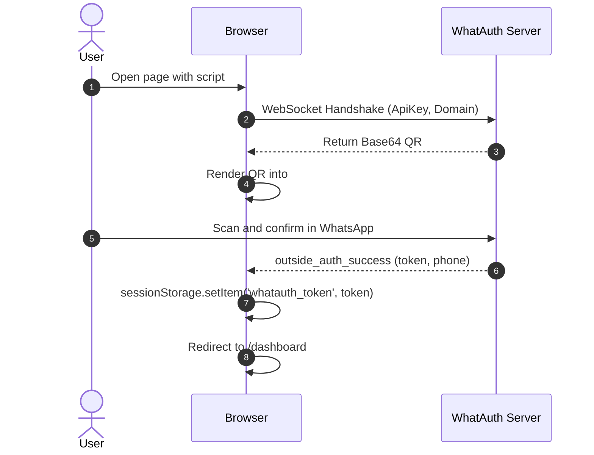
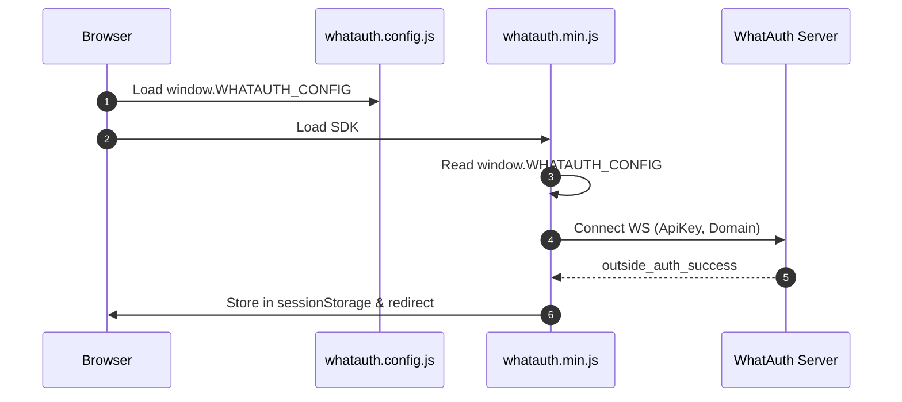
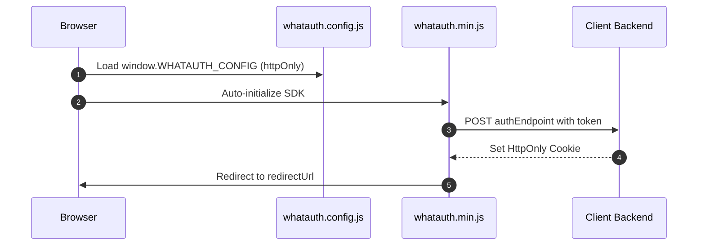

# WhatAuth CDN SDK

Integration guide for the minified WhatAuth CDN SDK (Vanilla JavaScript) using script tag attributes or global configuration file.

---

## Prerequisites

1. Sign up at whatauth.com
2. Have an active license plan
3. In the LoginQR section: customize the QR with domain, phrase, emojis, and JWT Secret
4. Create a public ApiKey in the API section

---

## 1. Script Attributes (Vanilla HTML)

The `<script>` tag configures and auto-initializes the SDK by reading its data-* attributes.

### sessionStorage Mode

Saves the JWT token into browser session storage and performs optional redirection.

```html
<!-- DOM Elements -->

<a id="whatauth-link">Login with WhatsApp</a>
<div id="whatauth-expired" style="display: none;">
  <span>Session Expired</span>
  <button onclick="location.reload()">Retry</button>
</div>
<div id="whatauth-status"></div>

<!-- WhatAuth CDN Script -->
<script 
  src="https://cdn.whatauth.com/v1.0.0/whatauth.min.js" 
  data-api-key="wk_live_YOUR_API_KEY"
  data-ws-url="https://api.whatauth.com"
  data-storage="sessionStorage"
  data-redirect-url="/dashboard"
  data-domain="yourdomain.com">
</script>
```



### httpOnly Mode

Dispatches the token via POST request with credentials to your backend to set secure HttpOnly cookies.

```html
<!-- DOM Elements -->

<a id="whatauth-link">Login with WhatsApp</a>
<div id="whatauth-expired" style="display: none;">
  <span>Session Expired</span>
  <button onclick="location.reload()">Retry</button>
</div>
<div id="whatauth-status"></div>

<!-- WhatAuth CDN Script (httpOnly mode) -->
<script 
  src="https://cdn.whatauth.com/v1.0.0/whatauth.min.js" 
  data-api-key="wk_live_YOUR_API_KEY"
  data-ws-url="https://api.whatauth.com"
  data-storage="httpOnly"
  data-auth-endpoint="/api/auth/login"
  data-redirect-url="/dashboard"
  data-domain="yourdomain.com">
</script>
```

```mermaid
sequenceDiagram
    autonumber
    actor U as User
    participant B as Browser
    participant S as Client Backend
    participant WS as WhatAuth Server
    B->>WS: Connect WS with ApiKey and Domain
    WS-->>B: Emit QR Code
    U->>WS: Scan via WhatsApp
    WS-->>B: outside_auth_success (token, phone)
    B->>S: POST /api/auth/login (token, credentials: include)
    S-->>B: Set-Cookie: session=...; HttpOnly; Secure
    B->>B: Redirect to /dashboard
```

---

## 2. Global File whatauth.config.js

Decouples configuration into an independent file. The SDK merges these values without requiring inline script tag attributes.

### sessionStorage Mode

```javascript
// whatauth.config.js
window.WHATAUTH_CONFIG = {
  apiKey: 'wk_live_YOUR_API_KEY',
  wsUrl: 'https://api.whatauth.com',
  domain: window.location.host,
  storage: 'sessionStorage',
  redirectUrl: '/dashboard'
};
```

```html
<!-- Load Config & CDN -->
<script src="./whatauth.config.js"></script>
<script src="https://cdn.whatauth.com/v1.0.0/whatauth.min.js"></script>
```



### httpOnly Mode

```javascript
// whatauth.config.js
window.WHATAUTH_CONFIG = {
  apiKey: 'wk_live_YOUR_API_KEY',
  wsUrl: 'https://api.whatauth.com',
  domain: window.location.host,
  storage: 'httpOnly',
  authEndpoint: '/api/auth/login',
  redirectUrl: '/dashboard'
};
```

```html
<!-- Load Config & CDN -->
<script src="./whatauth.config.js"></script>
<script src="https://cdn.whatauth.com/v1.0.0/whatauth.min.js"></script>
```



---

## 3. Parameters and Equivalences Matrix

| Script Attribute | Config Property | Description |
|---|---|---|
| `data-api-key` | `apiKey` | Public API key generated in console (wk_live_...). Required. |
| `data-ws-url` | `wsUrl` | WebSocket server URL (https://api.whatauth.com). |
| `data-domain` | `domain` | Authorized domain. Defaults to window.location.host. |
| `data-storage` | `storage` | Session mode: sessionStorage or httpOnly. |
| `data-redirect-url` | `redirectUrl` | Automatic navigation route after successful validation. |
| `data-auth-endpoint` | `authEndpoint` | POST endpoint required exclusively in httpOnly mode. |
| `data-qr-id` | `qrId` | DOM ID for the container or image of the QR (def: whatauth-qr). |
| `data-link-id` | `linkId` | DOM ID for WhatsApp button/link (def: whatauth-link). |
| `data-expired-id` | `expiredId` | DOM ID for expiration message overlay (def: whatauth-expired). |
| `data-status-id` | `statusId` | DOM ID for status message container (def: whatauth-status). |
| `data-pin-id` | `pinId` | DOM ID for numeric PIN container (def: whatauth-pin). |
