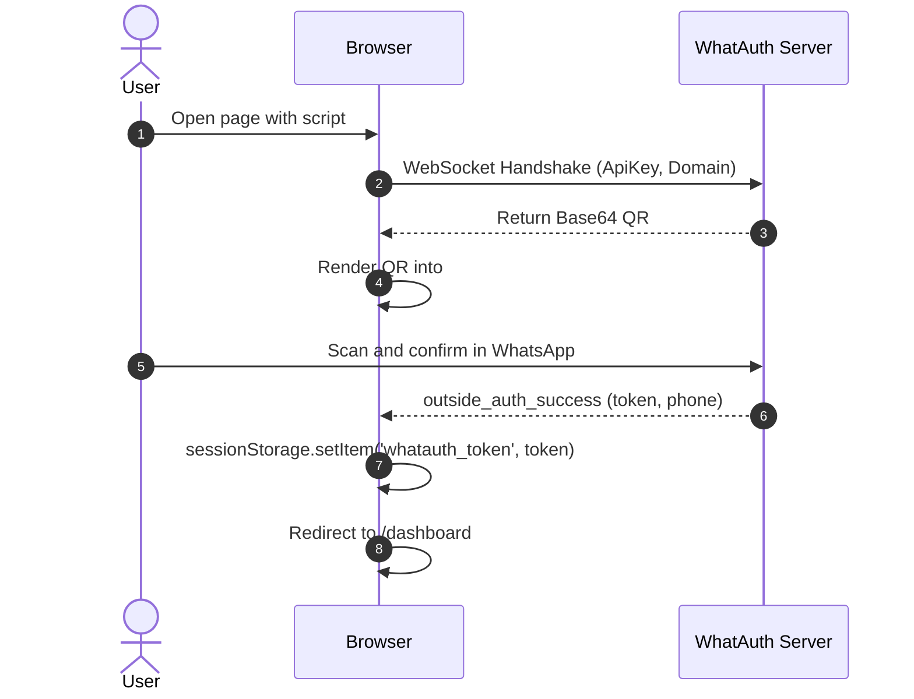
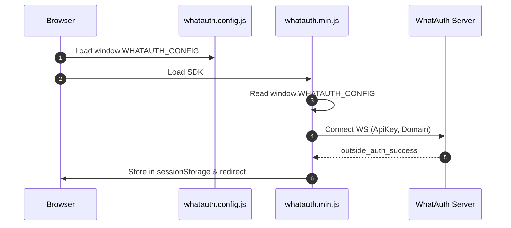
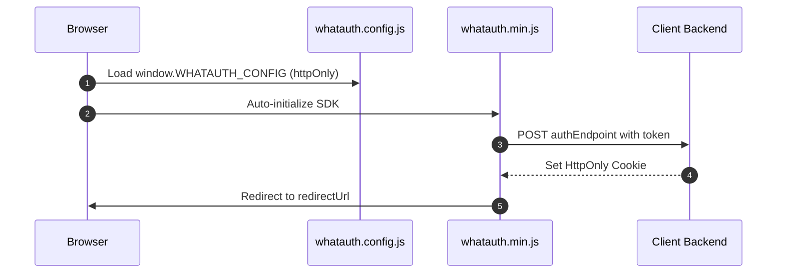

# WhatAuth CDN SDK

Guía de integración del SDK CDN minificado de WhatAuth (JavaScript Vanilla) mediante atributos en etiqueta script o archivo de configuración global.

---

## Requisitos Previos

1. Registrarse en whatauth.com
2. Tener una licencia activa
3. En la sección LoginQR: personalizar el QR con dominio, frase, emojis y Secret JWT
4. Crear una ApiKey pública en la sección API

---

## 1. Atributos en Script (Vanilla HTML)

La etiqueta `<script>` configura y auto-inicializa el SDK leyendo sus atributos data-*.

### Modalidad sessionStorage

Guarda el token JWT en el almacenamiento de sesión del navegador y ejecuta la redirección opcional.

```html
<!-- DOM Elements -->

<a id="whatauth-link">Login with WhatsApp</a>
<div id="whatauth-expired" style="display: none;">
  <span>Session Expired</span>
  <button onclick="location.reload()">Retry</button>
</div>
<div id="whatauth-status"></div>

<!-- WhatAuth CDN Script -->
<script 
  src="https://cdn.whatauth.com/v1.0.0/whatauth.min.js" 
  data-api-key="wk_live_YOUR_API_KEY"
  data-ws-url="https://api.whatauth.com"
  data-storage="sessionStorage"
  data-redirect-url="/dashboard"
  data-domain="yourdomain.com">
</script>
```



### Modalidad httpOnly

Envía el token mediante una solicitud POST con credenciales a tu backend para establecer cookies seguras HttpOnly.

```html
<!-- DOM Elements -->

<a id="whatauth-link">Login with WhatsApp</a>
<div id="whatauth-expired" style="display: none;">
  <span>Session Expired</span>
  <button onclick="location.reload()">Retry</button>
</div>
<div id="whatauth-status"></div>

<!-- WhatAuth CDN Script (httpOnly mode) -->
<script 
  src="https://cdn.whatauth.com/v1.0.0/whatauth.min.js" 
  data-api-key="wk_live_YOUR_API_KEY"
  data-ws-url="https://api.whatauth.com"
  data-storage="httpOnly"
  data-auth-endpoint="/api/auth/login"
  data-redirect-url="/dashboard"
  data-domain="yourdomain.com">
</script>
```

```mermaid
sequenceDiagram
    autonumber
    actor U as User
    participant B as Browser
    participant S as Client Backend
    participant WS as WhatAuth Server
    B->>WS: Connect WS with ApiKey and Domain
    WS-->>B: Emit QR Code
    U->>WS: Scan via WhatsApp
    WS-->>B: outside_auth_success (token, phone)
    B->>S: POST /api/auth/login (token, credentials: include)
    S-->>B: Set-Cookie: session=...; HttpOnly; Secure
    B->>B: Redirect to /dashboard
```

---

## 2. Archivo Global whatauth.config.js

Separación de la configuración en un archivo independiente. El SDK fusiona estos valores sin necesidad de atributos en la etiqueta `<script>`.

### Modalidad sessionStorage

```javascript
// whatauth.config.js
window.WHATAUTH_CONFIG = {
  apiKey: 'wk_live_YOUR_API_KEY',
  wsUrl: 'https://api.whatauth.com',
  domain: window.location.host,
  storage: 'sessionStorage',
  redirectUrl: '/dashboard'
};
```

```html
<!-- Load Config & CDN -->
<script src="./whatauth.config.js"></script>
<script src="https://cdn.whatauth.com/v1.0.0/whatauth.min.js"></script>
```



### Modalidad httpOnly

```javascript
// whatauth.config.js
window.WHATAUTH_CONFIG = {
  apiKey: 'wk_live_YOUR_API_KEY',
  wsUrl: 'https://api.whatauth.com',
  domain: window.location.host,
  storage: 'httpOnly',
  authEndpoint: '/api/auth/login',
  redirectUrl: '/dashboard'
};
```

```html
<!-- Load Config & CDN -->
<script src="./whatauth.config.js"></script>
<script src="https://cdn.whatauth.com/v1.0.0/whatauth.min.js"></script>
```



---

## 3. Matriz de Parámetros y Equivalencias

| Parámetro Script | Propiedad Config | Descripción |
|---|---|---|
| `data-api-key` | `apiKey` | Clave pública generada en el panel (wk_live_...). Obligatorio. |
| `data-ws-url` | `wsUrl` | Servidor WebSocket (https://api.whatauth.com). |
| `data-domain` | `domain` | Dominio autorizado. Por defecto window.location.host. |
| `data-storage` | `storage` | Modo de sesión: sessionStorage o httpOnly. |
| `data-redirect-url` | `redirectUrl` | Ruta de navegación automática tras validación exitosa. |
| `data-auth-endpoint` | `authEndpoint` | Ruta POST requerida únicamente en modo httpOnly. |
| `data-qr-id` | `qrId` | ID del contenedor o imagen para el QR (def: whatauth-qr). |
| `data-link-id` | `linkId` | ID del botón/enlace para WhatsApp (def: whatauth-link). |
| `data-expired-id` | `expiredId` | ID del mensaje de expiración (def: whatauth-expired). |
| `data-status-id` | `statusId` | ID del contenedor de estado (def: whatauth-status). |
| `data-pin-id` | `pinId` | ID del contenedor del PIN numérico (def: whatauth-pin). |
