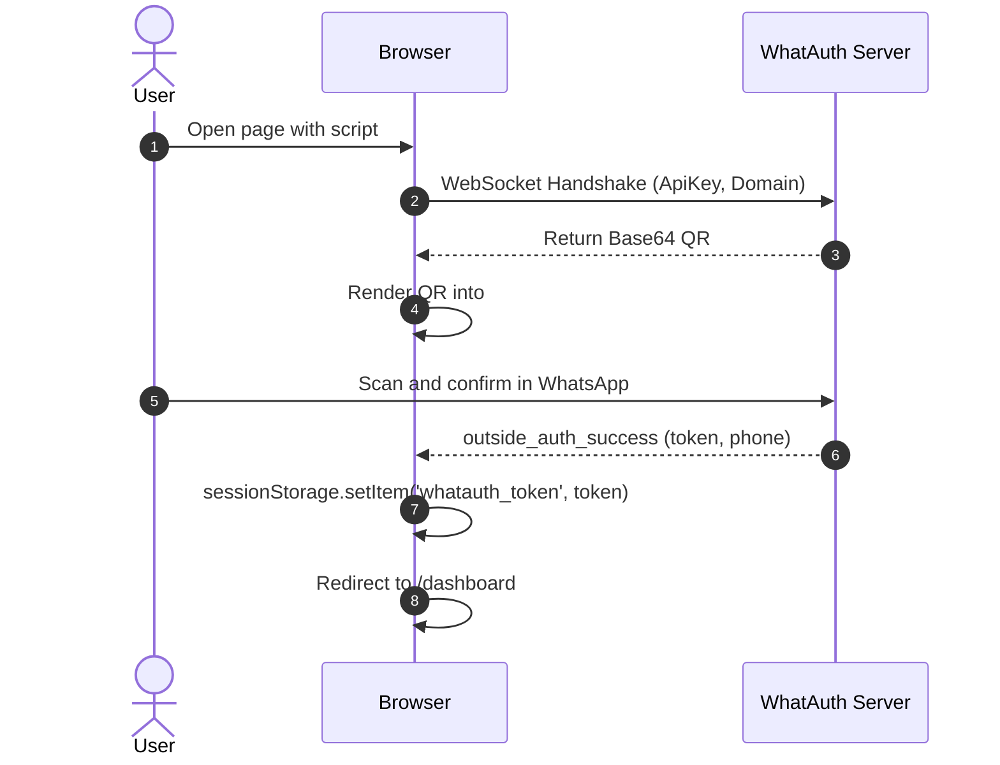
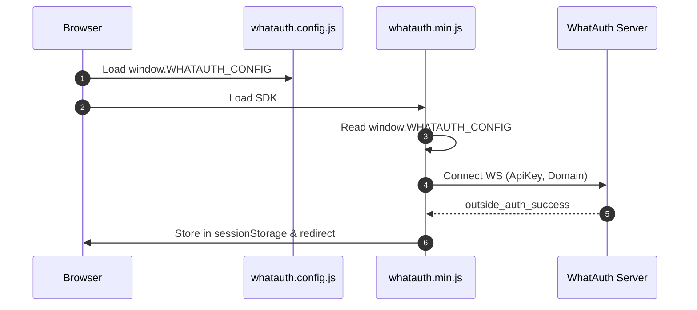
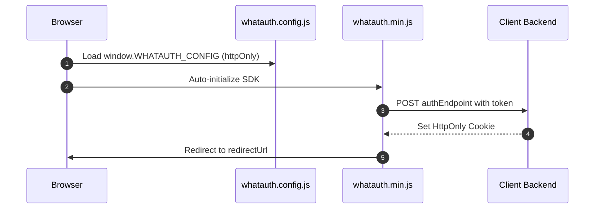

# WhatAuth CDN SDK

Guide d'intégration du SDK CDN minifié de WhatAuth (JavaScript Vanilla) via attributs de balise script ou fichier de configuration global.

---

## Prérequis

1. S'inscrire sur whatauth.com
2. Avoir une licence active
3. Dans la section LoginQR: personnaliser le QR avec domaine, phrase, emojis et Secret JWT
4. Créer une ApiKey publique dans la section API

---

## 1. Attributs de Script (Vanilla HTML)

La balise `<script>` configure et initialise automatiquement le SDK en lisant ses attributs data-*.

### Mode sessionStorage

Enregistre le jeton JWT dans le sessionStorage du navigateur et exécute la redirection facultative.

```html
<!-- DOM Elements -->

<a id="whatauth-link">Login with WhatsApp</a>
<div id="whatauth-expired" style="display: none;">
  <span>Session Expired</span>
  <button onclick="location.reload()">Retry</button>
</div>
<div id="whatauth-status"></div>

<!-- WhatAuth CDN Script -->
<script 
  src="https://cdn.whatauth.com/v1.0.0/whatauth.min.js" 
  data-api-key="wk_live_YOUR_API_KEY"
  data-ws-url="https://api.whatauth.com"
  data-storage="sessionStorage"
  data-redirect-url="/dashboard"
  data-domain="yourdomain.com">
</script>
```



### Mode httpOnly

Transmet le jeton via une requête POST avec informations d'authentification à votre backend pour définir des cookies sécurisés HttpOnly.

```html
<!-- DOM Elements -->

<a id="whatauth-link">Login with WhatsApp</a>
<div id="whatauth-expired" style="display: none;">
  <span>Session Expired</span>
  <button onclick="location.reload()">Retry</button>
</div>
<div id="whatauth-status"></div>

<!-- WhatAuth CDN Script (httpOnly mode) -->
<script 
  src="https://cdn.whatauth.com/v1.0.0/whatauth.min.js" 
  data-api-key="wk_live_YOUR_API_KEY"
  data-ws-url="https://api.whatauth.com"
  data-storage="httpOnly"
  data-auth-endpoint="/api/auth/login"
  data-redirect-url="/dashboard"
  data-domain="yourdomain.com">
</script>
```

```mermaid
sequenceDiagram
    autonumber
    actor U as User
    participant B as Browser
    participant S as Client Backend
    participant WS as WhatAuth Server
    B->>WS: Connect WS with ApiKey and Domain
    WS-->>B: Emit QR Code
    U->>WS: Scan via WhatsApp
    WS-->>B: outside_auth_success (token, phone)
    B->>S: POST /api/auth/login (token, credentials: include)
    S-->>B: Set-Cookie: session=...; HttpOnly; Secure
    B->>B: Redirect to /dashboard
```

---

## 2. Fichier Global whatauth.config.js

Séparation de la configuration dans un fichier externe. Le SDK fusionne ces valeurs sans nécessiter d'attributs dans la balise `<script>`.

### Mode sessionStorage

```javascript
// whatauth.config.js
window.WHATAUTH_CONFIG = {
  apiKey: 'wk_live_YOUR_API_KEY',
  wsUrl: 'https://api.whatauth.com',
  domain: window.location.host,
  storage: 'sessionStorage',
  redirectUrl: '/dashboard'
};
```

```html
<!-- Load Config & CDN -->
<script src="./whatauth.config.js"></script>
<script src="https://cdn.whatauth.com/v1.0.0/whatauth.min.js"></script>
```



### Mode httpOnly

```javascript
// whatauth.config.js
window.WHATAUTH_CONFIG = {
  apiKey: 'wk_live_YOUR_API_KEY',
  wsUrl: 'https://api.whatauth.com',
  domain: window.location.host,
  storage: 'httpOnly',
  authEndpoint: '/api/auth/login',
  redirectUrl: '/dashboard'
};
```

```html
<!-- Load Config & CDN -->
<script src="./whatauth.config.js"></script>
<script src="https://cdn.whatauth.com/v1.0.0/whatauth.min.js"></script>
```



---

## 3. Matrice des Paramètres et Équivalences

| Attribut Script | Propriété Config | Description |
|---|---|---|
| `data-api-key` | `apiKey` | Clé API publique générée sur le panneau (wk_live_...). Obligatoire. |
| `data-ws-url` | `wsUrl` | Serveur WebSocket (https://api.whatauth.com). |
| `data-domain` | `domain` | Domaine autorisé. Défaut: window.location.host. |
| `data-storage` | `storage` | Mode de session: sessionStorage ou httpOnly. |
| `data-redirect-url` | `redirectUrl` | URL de redirection automatique après validation. |
| `data-auth-endpoint` | `authEndpoint` | Point de terminaison POST requis uniquement en mode httpOnly. |
| `data-qr-id` | `qrId` | ID du conteneur ou image pour le QR (déf: whatauth-qr). |
| `data-link-id` | `linkId` | ID du bouton/lien WhatsApp (déf: whatauth-link). |
| `data-expired-id` | `expiredId` | ID du conteneur d'expiration (déf: whatauth-expired). |
| `data-status-id` | `statusId` | ID du conteneur d'état (déf: whatauth-status). |
| `data-pin-id` | `pinId` | ID du conteneur du PIN numérique (déf: whatauth-pin). |
