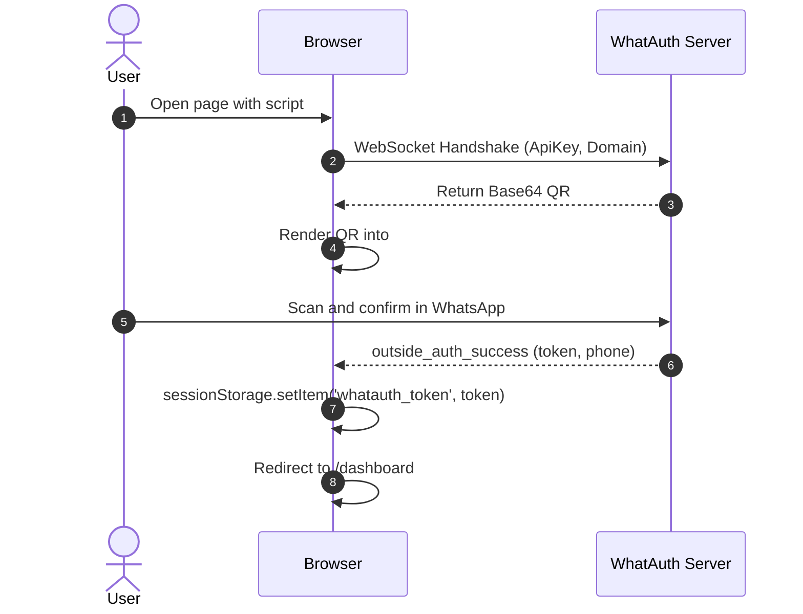
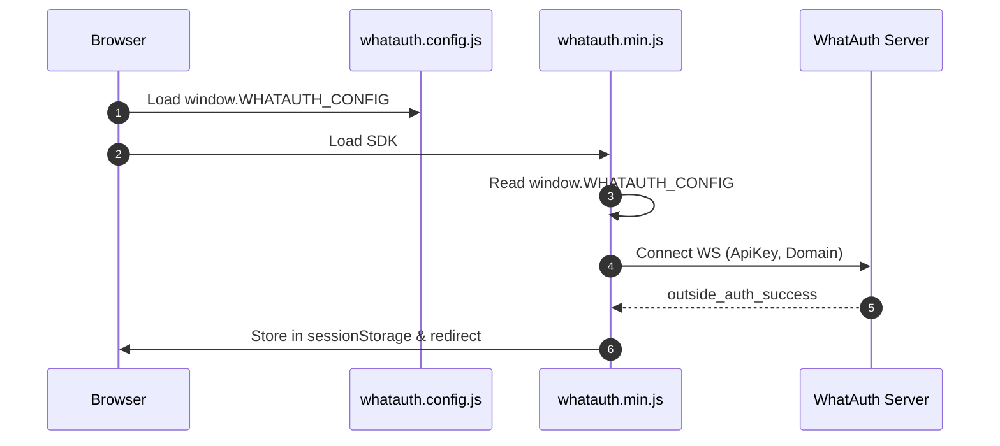
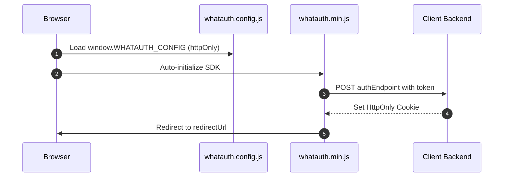

# WhatAuth CDN SDK

WhatAuth मिनिफाइड CDN SDK (वैनिला जावास्क्रिप्ट) एकीकरण गाइड, स्क्रिप्ट टैग विशेषताओं या वैश्विक कॉन्फ़िगरेशन फ़ाइल द्वारा।

---

## पूर्वापेक्षाएँ (Prerequisites)

1. whatauth.com पर पंजीकरण करें
2. एक सक्रिय लाइसेंस योजना रखें
3. LoginQR अनुभाग में: डोमेन, वाक्यांश, इमोजी और JWT Secret के साथ QR अनुकूलित करें
4. API अनुभाग में एक सार्वजनिक ApiKey बनाएँ

---

## 1. स्क्रिप्ट विशेषताएँ (Vanilla HTML)

`<script>` टैग अपने data-* विशेषताओं को पढ़कर SDK को कॉन्फ़िगर और स्वचालित रूप से प्रारंभ करता है।

### sessionStorage मोड

ब्राउज़र के sessionStorage में JWT टोकन संग्रहीत करता है और वैकल्पिक पुनर्निर्देशन निष्पादित करता है।

```html
<!-- DOM Elements -->

<a id="whatauth-link">Login with WhatsApp</a>
<div id="whatauth-expired" style="display: none;">
  <span>Session Expired</span>
  <button onclick="location.reload()">Retry</button>
</div>
<div id="whatauth-status"></div>

<!-- WhatAuth CDN Script -->
<script 
  src="https://cdn.whatauth.com/v1.0.0/whatauth.min.js" 
  data-api-key="wk_live_YOUR_API_KEY"
  data-ws-url="https://api.whatauth.com"
  data-storage="sessionStorage"
  data-redirect-url="/dashboard"
  data-domain="yourdomain.com">
</script>
```



### httpOnly मोड

सुरक्षित HttpOnly कुकीज़ सेट करने के लिए क्रेडेंशियल्स के साथ बैकएंड पर POST अनुरोध के माध्यम से टोकन भेजता है।

```html
<!-- DOM Elements -->

<a id="whatauth-link">Login with WhatsApp</a>
<div id="whatauth-expired" style="display: none;">
  <span>Session Expired</span>
  <button onclick="location.reload()">Retry</button>
</div>
<div id="whatauth-status"></div>

<!-- WhatAuth CDN Script (httpOnly mode) -->
<script 
  src="https://cdn.whatauth.com/v1.0.0/whatauth.min.js" 
  data-api-key="wk_live_YOUR_API_KEY"
  data-ws-url="https://api.whatauth.com"
  data-storage="httpOnly"
  data-auth-endpoint="/api/auth/login"
  data-redirect-url="/dashboard"
  data-domain="yourdomain.com">
</script>
```

```mermaid
sequenceDiagram
    autonumber
    actor U as User
    participant B as Browser
    participant S as Client Backend
    participant WS as WhatAuth Server
    B->>WS: Connect WS with ApiKey and Domain
    WS-->>B: Emit QR Code
    U->>WS: Scan via WhatsApp
    WS-->>B: outside_auth_success (token, phone)
    B->>S: POST /api/auth/login (token, credentials: include)
    S-->>B: Set-Cookie: session=...; HttpOnly; Secure
    B->>B: Redirect to /dashboard
```

---

## 2. वैश्विक फ़ाइल whatauth.config.js

कॉन्फ़िगरेशन को एक स्वतंत्र फ़ाइल में अलग करना। SDK बिना इनलाइन विशेषताओं के इन मानों को संयोजित करता है।

### sessionStorage मोड

```javascript
// whatauth.config.js
window.WHATAUTH_CONFIG = {
  apiKey: 'wk_live_YOUR_API_KEY',
  wsUrl: 'https://api.whatauth.com',
  domain: window.location.host,
  storage: 'sessionStorage',
  redirectUrl: '/dashboard'
};
```

```html
<!-- Load Config & CDN -->
<script src="./whatauth.config.js"></script>
<script src="https://cdn.whatauth.com/v1.0.0/whatauth.min.js"></script>
```



### httpOnly मोड

```javascript
// whatauth.config.js
window.WHATAUTH_CONFIG = {
  apiKey: 'wk_live_YOUR_API_KEY',
  wsUrl: 'https://api.whatauth.com',
  domain: window.location.host,
  storage: 'httpOnly',
  authEndpoint: '/api/auth/login',
  redirectUrl: '/dashboard'
};
```

```html
<!-- Load Config & CDN -->
<script src="./whatauth.config.js"></script>
<script src="https://cdn.whatauth.com/v1.0.0/whatauth.min.js"></script>
```



---

## 3. पैरामीटर और समतुल्यता तालिका

| स्क्रिप्ट पैरामीटर | कॉन्फ़िग प्रॉपर्टी | विवरण |
|---|---|---|
| `data-api-key` | `apiKey` | कंसोल में उत्पन्न सार्वजनिक एपीआई कुंजी (wk_live_...). आवश्यक। |
| `data-ws-url` | `wsUrl` | WebSocket सर्वर (https://api.whatauth.com)। |
| `data-domain` | `domain` | अधिकृत डोमेन। डिफ़ॉल्ट window.location.host। |
| `data-storage` | `storage` | सत्र मोड: sessionStorage या httpOnly। |
| `data-redirect-url` | `redirectUrl` | सफल प्रमाणीकरण के बाद स्वचालित नेविगेशन पथ। |
| `data-auth-endpoint` | `authEndpoint` | केवल httpOnly मोड में आवश्यक POST एंडपॉइंट। |
| `data-qr-id` | `qrId` | क्यूआर कोड कंटेनर या छवि आईडी (डिफ़ॉल्ट: whatauth-qr)। |
| `data-link-id` | `linkId` | व्हाट्सएप बटन/लिंक आईडी (डिफ़ॉल्ट: whatauth-link)। |
| `data-expired-id` | `expiredId` | समाप्ति संदेश कंटेनर आईडी (डिफ़ॉल्ट: whatauth-expired)। |
| `data-status-id` | `statusId` | स्थिति संदेश कंटेनर आईडी (डिफ़ॉल्ट: whatauth-status)। |
| `data-pin-id` | `pinId` | संख्यात्मक पिन कंटेनर आईडी (डिफ़ॉल्ट: whatauth-pin)। |
