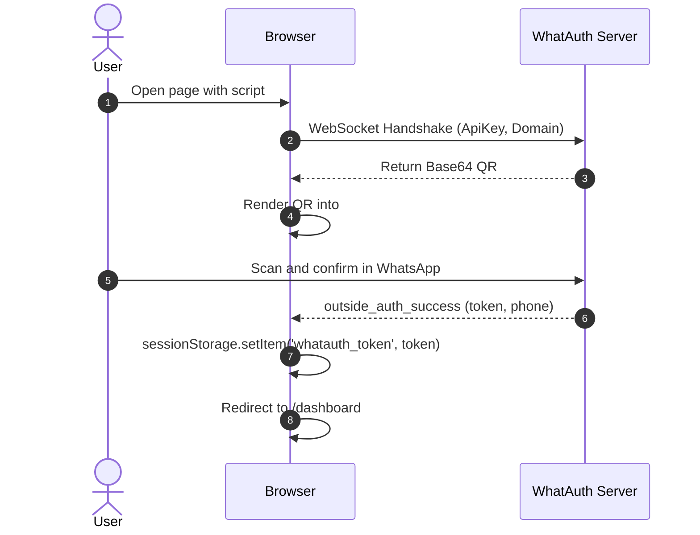
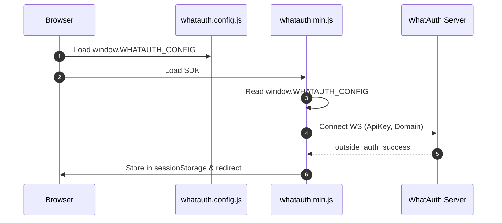
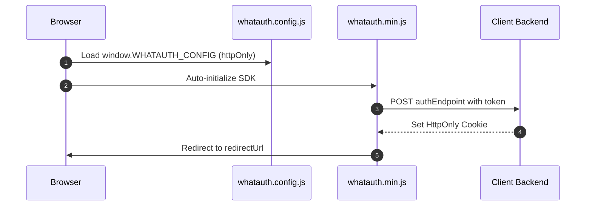

# WhatAuth CDN SDK

Guida all'integrazione dell'SDK CDN minificato di WhatAuth (JavaScript Vanilla) tramite attributi script o file di configurazione globale.

---

## Prerequisiti

1. Registrarsi su whatauth.com
2. Avere una licenza attiva
3. Nella sezione LoginQR: personalizzare il QR con dominio, frase, emoji e Secret JWT
4. Creare un'ApiKey pubblica nella sezione API

---

## 1. Attributi Script (Vanilla HTML)

Il tag `<script>` configura e inizializza automaticamente l'SDK leggendo i suoi attributi data-*.

### Modalità sessionStorage

Salva il token JWT nell'archiviazione di sessione del browser ed esegue il reindirizzamento facoltativo.

```html
<!-- DOM Elements -->

<a id="whatauth-link">Login with WhatsApp</a>
<div id="whatauth-expired" style="display: none;">
  <span>Session Expired</span>
  <button onclick="location.reload()">Retry</button>
</div>
<div id="whatauth-status"></div>

<!-- WhatAuth CDN Script -->
<script 
  src="https://cdn.whatauth.com/v1.0.0/whatauth.min.js" 
  data-api-key="wk_live_YOUR_API_KEY"
  data-ws-url="https://api.whatauth.com"
  data-storage="sessionStorage"
  data-redirect-url="/dashboard"
  data-domain="yourdomain.com">
</script>
```



### Modalità httpOnly

Invia il token tramite richiesta POST con credenziali al backend per impostare cookie sicuri HttpOnly.

```html
<!-- DOM Elements -->

<a id="whatauth-link">Login with WhatsApp</a>
<div id="whatauth-expired" style="display: none;">
  <span>Session Expired</span>
  <button onclick="location.reload()">Retry</button>
</div>
<div id="whatauth-status"></div>

<!-- WhatAuth CDN Script (httpOnly mode) -->
<script 
  src="https://cdn.whatauth.com/v1.0.0/whatauth.min.js" 
  data-api-key="wk_live_YOUR_API_KEY"
  data-ws-url="https://api.whatauth.com"
  data-storage="httpOnly"
  data-auth-endpoint="/api/auth/login"
  data-redirect-url="/dashboard"
  data-domain="yourdomain.com">
</script>
```

```mermaid
sequenceDiagram
    autonumber
    actor U as User
    participant B as Browser
    participant S as Client Backend
    participant WS as WhatAuth Server
    B->>WS: Connect WS with ApiKey and Domain
    WS-->>B: Emit QR Code
    U->>WS: Scan via WhatsApp
    WS-->>B: outside_auth_success (token, phone)
    B->>S: POST /api/auth/login (token, credentials: include)
    S-->>B: Set-Cookie: session=...; HttpOnly; Secure
    B->>B: Redirect to /dashboard
```

---

## 2. File Globale whatauth.config.js

Separazione della configurazione in un file indipendente. L'SDK unisce questi valori senza attributi nel tag `<script>`.

### Modalità sessionStorage

```javascript
// whatauth.config.js
window.WHATAUTH_CONFIG = {
  apiKey: 'wk_live_YOUR_API_KEY',
  wsUrl: 'https://api.whatauth.com',
  domain: window.location.host,
  storage: 'sessionStorage',
  redirectUrl: '/dashboard'
};
```

```html
<!-- Load Config & CDN -->
<script src="./whatauth.config.js"></script>
<script src="https://cdn.whatauth.com/v1.0.0/whatauth.min.js"></script>
```



### Modalità httpOnly

```javascript
// whatauth.config.js
window.WHATAUTH_CONFIG = {
  apiKey: 'wk_live_YOUR_API_KEY',
  wsUrl: 'https://api.whatauth.com',
  domain: window.location.host,
  storage: 'httpOnly',
  authEndpoint: '/api/auth/login',
  redirectUrl: '/dashboard'
};
```

```html
<!-- Load Config & CDN -->
<script src="./whatauth.config.js"></script>
<script src="https://cdn.whatauth.com/v1.0.0/whatauth.min.js"></script>
```



---

## 3. Matrice dei Parametri ed Equivalenze

| Attributo Script | Proprietà Config | Descrizione |
|---|---|---|
| `data-api-key` | `apiKey` | Chiave API pubblica generata nel pannello (wk_live_...). Obbligatorio. |
| `data-ws-url` | `wsUrl` | Server WebSocket (https://api.whatauth.com). |
| `data-domain` | `domain` | Dominio autorizzato. Predefinito window.location.host. |
| `data-storage` | `storage` | Modalità sessione: sessionStorage o httpOnly. |
| `data-redirect-url` | `redirectUrl` | Percorso di navigazione automatica dopo la convalida. |
| `data-auth-endpoint` | `authEndpoint` | Endpoint POST richiesto solo in modalità httpOnly. |
| `data-qr-id` | `qrId` | ID del contenitore o immagine per il QR (def: whatauth-qr). |
| `data-link-id` | `linkId` | ID del pulsante/link per WhatsApp (def: whatauth-link). |
| `data-expired-id` | `expiredId` | ID del messaggio di scadenza (def: whatauth-expired). |
| `data-status-id` | `statusId` | ID del contenitore di stato (def: whatauth-status). |
| `data-pin-id` | `pinId` | ID del contenitore PIN numerico (def: whatauth-pin). |
