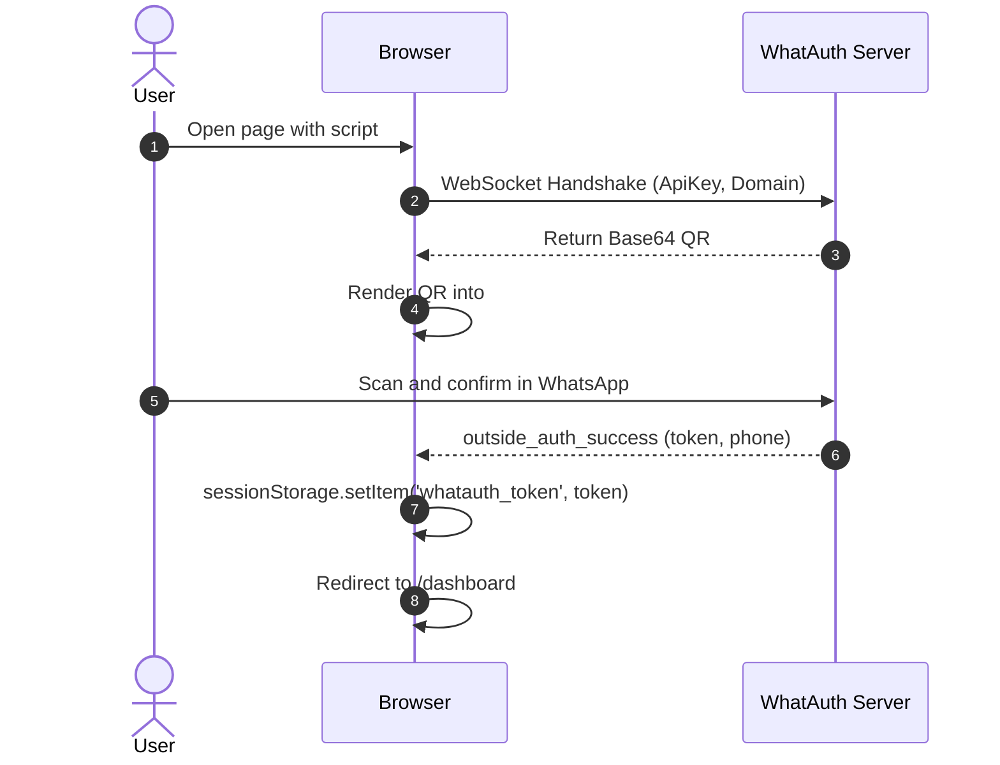
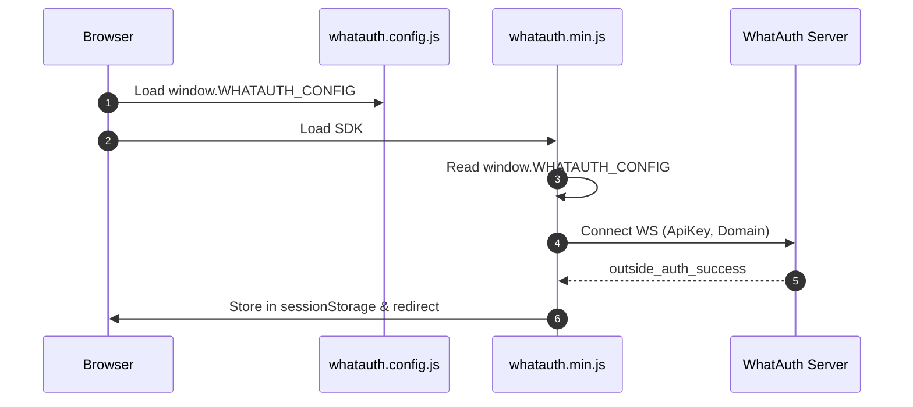
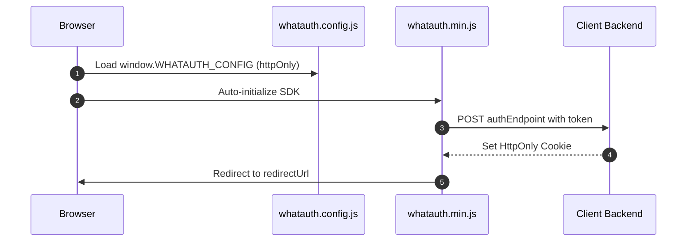

# WhatAuth CDN SDK

WhatAuth CDN 圧縮版 SDK (バニラ JavaScript) 導入ガイド。script タグ属性または外部設定ファイルによる設定方法。

---

## 事前準備 (前提条件)

1. whatauth.com でアカウント登録を行う
2. 有効なライセンスプランを契約していること
3. LoginQR セクションでドメイン、フレーズ、絵文字、JWT Secret を設定する
4. API セクションで公開 ApiKey を作成する

---

## 1. Script 属性による設定 (Vanilla HTML)

`<script>` タグの data-* 属性を読み取って SDK を設定し、自動初期化します。

### sessionStorage モード

ブラウザの sessionStorage に JWT トークンを保存し、指定された URL へ自動遷移します。

```html
<!-- DOM Elements -->

<a id="whatauth-link">Login with WhatsApp</a>
<div id="whatauth-expired" style="display: none;">
  <span>Session Expired</span>
  <button onclick="location.reload()">Retry</button>
</div>
<div id="whatauth-status"></div>

<!-- WhatAuth CDN Script -->
<script 
  src="https://cdn.whatauth.com/v1.0.0/whatauth.min.js" 
  data-api-key="wk_live_YOUR_API_KEY"
  data-ws-url="https://api.whatauth.com"
  data-storage="sessionStorage"
  data-redirect-url="/dashboard"
  data-domain="yourdomain.com">
</script>
```



### httpOnly モード

安全な HttpOnly Cookie を設定するため、認証情報を付加した POST リクエストでバックエンドにトークンを送信します。

```html
<!-- DOM Elements -->

<a id="whatauth-link">Login with WhatsApp</a>
<div id="whatauth-expired" style="display: none;">
  <span>Session Expired</span>
  <button onclick="location.reload()">Retry</button>
</div>
<div id="whatauth-status"></div>

<!-- WhatAuth CDN Script (httpOnly mode) -->
<script 
  src="https://cdn.whatauth.com/v1.0.0/whatauth.min.js" 
  data-api-key="wk_live_YOUR_API_KEY"
  data-ws-url="https://api.whatauth.com"
  data-storage="httpOnly"
  data-auth-endpoint="/api/auth/login"
  data-redirect-url="/dashboard"
  data-domain="yourdomain.com">
</script>
```

```mermaid
sequenceDiagram
    autonumber
    actor U as User
    participant B as Browser
    participant S as Client Backend
    participant WS as WhatAuth Server
    B->>WS: Connect WS with ApiKey and Domain
    WS-->>B: Emit QR Code
    U->>WS: Scan via WhatsApp
    WS-->>B: outside_auth_success (token, phone)
    B->>S: POST /api/auth/login (token, credentials: include)
    S-->>B: Set-Cookie: session=...; HttpOnly; Secure
    B->>B: Redirect to /dashboard
```

---

## 2. 外部設定ファイル whatauth.config.js

設定を別ファイルに分離します。SDK は script タグのインライン属性なしでこれらの設定を読み込みます。

### sessionStorage モード

```javascript
// whatauth.config.js
window.WHATAUTH_CONFIG = {
  apiKey: 'wk_live_YOUR_API_KEY',
  wsUrl: 'https://api.whatauth.com',
  domain: window.location.host,
  storage: 'sessionStorage',
  redirectUrl: '/dashboard'
};
```

```html
<!-- Load Config & CDN -->
<script src="./whatauth.config.js"></script>
<script src="https://cdn.whatauth.com/v1.0.0/whatauth.min.js"></script>
```



### httpOnly モード

```javascript
// whatauth.config.js
window.WHATAUTH_CONFIG = {
  apiKey: 'wk_live_YOUR_API_KEY',
  wsUrl: 'https://api.whatauth.com',
  domain: window.location.host,
  storage: 'httpOnly',
  authEndpoint: '/api/auth/login',
  redirectUrl: '/dashboard'
};
```

```html
<!-- Load Config & CDN -->
<script src="./whatauth.config.js"></script>
<script src="https://cdn.whatauth.com/v1.0.0/whatauth.min.js"></script>
```



---

## 3. パラメータと設定対応表

| Script 属性 | 設定プロパティ | 説明 |
|---|---|---|
| `data-api-key` | `apiKey` | 管理画面で発行された公開 API キー (wk_live_...)。必須。 |
| `data-ws-url` | `wsUrl` | WebSocket サーバー URL (https://api.whatauth.com)。 |
| `data-domain` | `domain` | 認証済みドメイン。デフォルトは window.location.host。 |
| `data-storage` | `storage` | 保存モード: sessionStorage または httpOnly。 |
| `data-redirect-url` | `redirectUrl` | 認証成功後の自動リダイレクト先 URL。 |
| `data-auth-endpoint` | `authEndpoint` | httpOnly モード時に必須となるバックエンド POST エンドポイント。 |
| `data-qr-id` | `qrId` | QR コード表示用コンテナまたは画像の ID (デフォルト: whatauth-qr)。 |
| `data-link-id` | `linkId` | WhatsApp 起動ボタン/リンクの ID (デフォルト: whatauth-link)。 |
| `data-expired-id` | `expiredId` | 有効期限切れメッセージの ID (デフォルト: whatauth-expired)。 |
| `data-status-id` | `statusId` | 接続状態表示用コンテナの ID (デフォルト: whatauth-status)。 |
| `data-pin-id` | `pinId` | 4桁の検証用 PIN コード表示コンテナ ID (デフォルト: whatauth-pin)。 |
