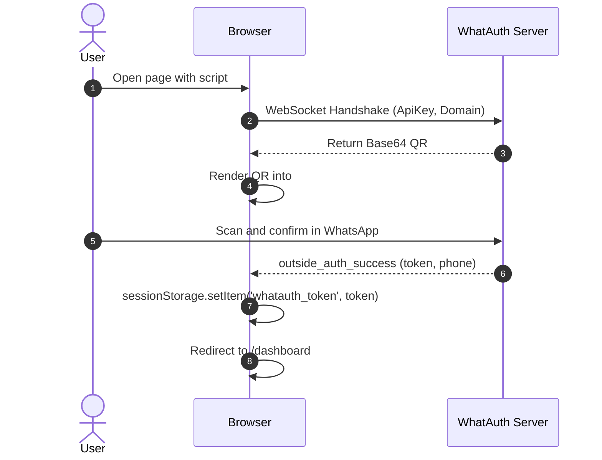
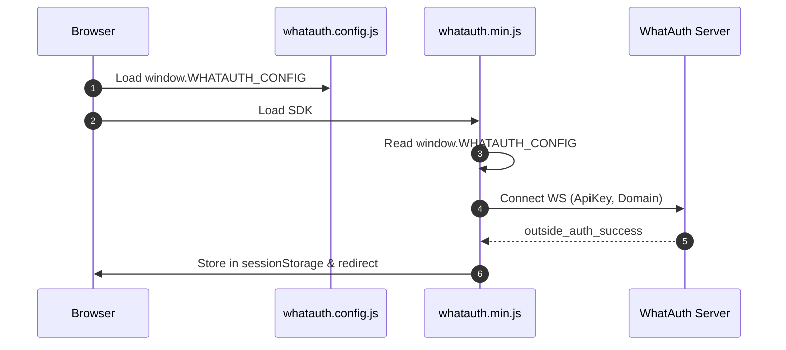
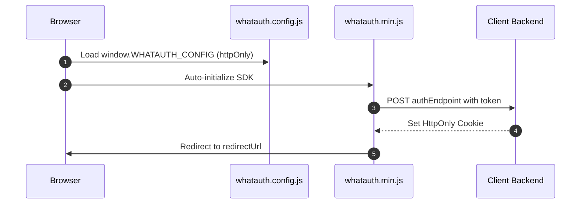

# WhatAuth CDN SDK

Guia de integração do SDK CDN minificado do WhatAuth (JavaScript Vanilla) por meio de atributos na tag script ou arquivo de configuração global.

---

## Pré-requisitos

1. Registrar-se em whatauth.com
2. Possuir uma licença ativa
3. Na seção LoginQR: personalizar o QR com domínio, frase, emojis e Secret JWT
4. Criar uma ApiKey pública na seção API

---

## 1. Atributos de Script (Vanilla HTML)

A tag `<script>` configura e inicializa automaticamente o SDK lendo seus atributos data-*.

### Modalidade sessionStorage

Armazena o token JWT no armazenamento de sessão do navegador e executa o redirecionamento opcional.

```html
<!-- DOM Elements -->

<a id="whatauth-link">Login with WhatsApp</a>
<div id="whatauth-expired" style="display: none;">
  <span>Session Expired</span>
  <button onclick="location.reload()">Retry</button>
</div>
<div id="whatauth-status"></div>

<!-- WhatAuth CDN Script -->
<script 
  src="https://cdn.whatauth.com/v1.0.0/whatauth.min.js" 
  data-api-key="wk_live_YOUR_API_KEY"
  data-ws-url="https://api.whatauth.com"
  data-storage="sessionStorage"
  data-redirect-url="/dashboard"
  data-domain="yourdomain.com">
</script>
```



### Modalidade httpOnly

Envia o token por meio de uma solicitação POST com credenciais ao seu backend para definir cookies HttpOnly seguros.

```html
<!-- DOM Elements -->

<a id="whatauth-link">Login with WhatsApp</a>
<div id="whatauth-expired" style="display: none;">
  <span>Session Expired</span>
  <button onclick="location.reload()">Retry</button>
</div>
<div id="whatauth-status"></div>

<!-- WhatAuth CDN Script (httpOnly mode) -->
<script 
  src="https://cdn.whatauth.com/v1.0.0/whatauth.min.js" 
  data-api-key="wk_live_YOUR_API_KEY"
  data-ws-url="https://api.whatauth.com"
  data-storage="httpOnly"
  data-auth-endpoint="/api/auth/login"
  data-redirect-url="/dashboard"
  data-domain="yourdomain.com">
</script>
```

```mermaid
sequenceDiagram
    autonumber
    actor U as User
    participant B as Browser
    participant S as Client Backend
    participant WS as WhatAuth Server
    B->>WS: Connect WS with ApiKey and Domain
    WS-->>B: Emit QR Code
    U->>WS: Scan via WhatsApp
    WS-->>B: outside_auth_success (token, phone)
    B->>S: POST /api/auth/login (token, credentials: include)
    S-->>B: Set-Cookie: session=...; HttpOnly; Secure
    B->>B: Redirect to /dashboard
```

---

## 2. Arquivo Global whatauth.config.js

Separação da configuração em um arquivo independente. O SDK mescla estes valores sem necessidade de atributos na tag `<script>`.

### Modalidade sessionStorage

```javascript
// whatauth.config.js
window.WHATAUTH_CONFIG = {
  apiKey: 'wk_live_YOUR_API_KEY',
  wsUrl: 'https://api.whatauth.com',
  domain: window.location.host,
  storage: 'sessionStorage',
  redirectUrl: '/dashboard'
};
```

```html
<!-- Load Config & CDN -->
<script src="./whatauth.config.js"></script>
<script src="https://cdn.whatauth.com/v1.0.0/whatauth.min.js"></script>
```



### Modalidade httpOnly

```javascript
// whatauth.config.js
window.WHATAUTH_CONFIG = {
  apiKey: 'wk_live_YOUR_API_KEY',
  wsUrl: 'https://api.whatauth.com',
  domain: window.location.host,
  storage: 'httpOnly',
  authEndpoint: '/api/auth/login',
  redirectUrl: '/dashboard'
};
```

```html
<!-- Load Config & CDN -->
<script src="./whatauth.config.js"></script>
<script src="https://cdn.whatauth.com/v1.0.0/whatauth.min.js"></script>
```



---

## 3. Matriz de Parâmetros e Equivalências

| Parâmetro Script | Propriedade Config | Descrição |
|---|---|---|
| `data-api-key` | `apiKey` | Chave pública da API gerada no painel (wk_live_...). Obrigatório. |
| `data-ws-url` | `wsUrl` | Servidor WebSocket (https://api.whatauth.com). |
| `data-domain` | `domain` | Domínio autorizado. Padrão window.location.host. |
| `data-storage` | `storage` | Modo de sessão: sessionStorage ou httpOnly. |
| `data-redirect-url` | `redirectUrl` | Rota de navegação automática após validação bem-sucedida. |
| `data-auth-endpoint` | `authEndpoint` | Endpoint POST obrigatório apenas no modo httpOnly. |
| `data-qr-id` | `qrId` | ID do contêiner ou imagem do QR (padrão: whatauth-qr). |
| `data-link-id` | `linkId` | ID do botão/link do WhatsApp (padrão: whatauth-link). |
| `data-expired-id` | `expiredId` | ID da mensagem de expiração (padrão: whatauth-expired). |
| `data-status-id` | `statusId` | ID do contêiner de status (padrão: whatauth-status). |
| `data-pin-id` | `pinId` | ID do contêiner de PIN numérico (padrão: whatauth-pin). |
