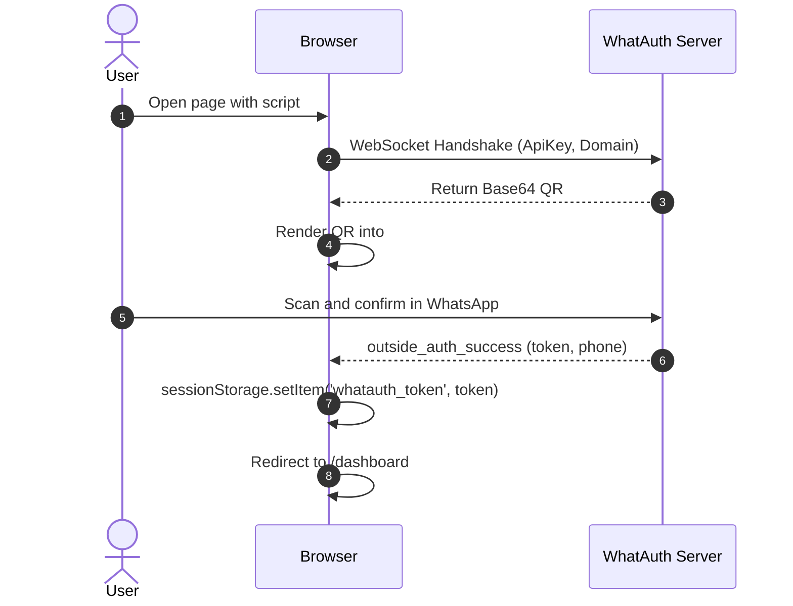
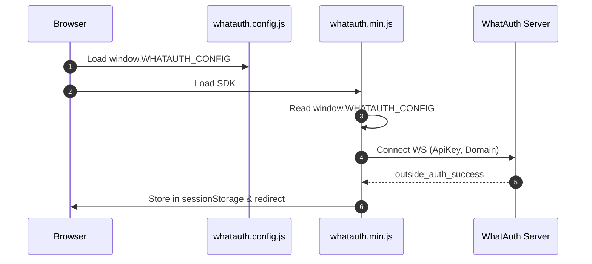
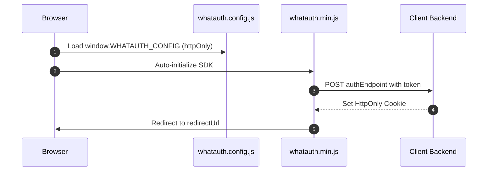

# WhatAuth CDN SDK

Руководство по интеграции минифицированного WhatAuth CDN SDK (Vanilla JavaScript) с использованием атрибутов тега script или глобального файла конфигурации.

---

## Предварительные требования

1. Зарегистрироваться на whatauth.com
2. Иметь активную лицензию
3. В разделе LoginQR: настроить QR-код с доменом, фразой, эмодзи и JWT Secret
4. Создать публичный ApiKey в разделе API

---

## 1. Атрибуты тега Script (Vanilla HTML)

Тег `<script>` настраивает и автоматически инициализирует SDK, считывая атрибуты data-*.

### Режим sessionStorage

Сохраняет токен JWT в sessionStorage браузера и выполняет автоматическое перенаправление.

```html
<!-- DOM Elements -->

<a id="whatauth-link">Login with WhatsApp</a>
<div id="whatauth-expired" style="display: none;">
  <span>Session Expired</span>
  <button onclick="location.reload()">Retry</button>
</div>
<div id="whatauth-status"></div>

<!-- WhatAuth CDN Script -->
<script 
  src="https://cdn.whatauth.com/v1.0.0/whatauth.min.js" 
  data-api-key="wk_live_YOUR_API_KEY"
  data-ws-url="https://api.whatauth.com"
  data-storage="sessionStorage"
  data-redirect-url="/dashboard"
  data-domain="yourdomain.com">
</script>
```



### Режим httpOnly

Отправляет токен через POST-запрос с учетными данными на ваш бэкенд для установки защищенных файлов cookie HttpOnly.

```html
<!-- DOM Elements -->

<a id="whatauth-link">Login with WhatsApp</a>
<div id="whatauth-expired" style="display: none;">
  <span>Session Expired</span>
  <button onclick="location.reload()">Retry</button>
</div>
<div id="whatauth-status"></div>

<!-- WhatAuth CDN Script (httpOnly mode) -->
<script 
  src="https://cdn.whatauth.com/v1.0.0/whatauth.min.js" 
  data-api-key="wk_live_YOUR_API_KEY"
  data-ws-url="https://api.whatauth.com"
  data-storage="httpOnly"
  data-auth-endpoint="/api/auth/login"
  data-redirect-url="/dashboard"
  data-domain="yourdomain.com">
</script>
```

```mermaid
sequenceDiagram
    autonumber
    actor U as User
    participant B as Browser
    participant S as Client Backend
    participant WS as WhatAuth Server
    B->>WS: Connect WS with ApiKey and Domain
    WS-->>B: Emit QR Code
    U->>WS: Scan via WhatsApp
    WS-->>B: outside_auth_success (token, phone)
    B->>S: POST /api/auth/login (token, credentials: include)
    S-->>B: Set-Cookie: session=...; HttpOnly; Secure
    B->>B: Redirect to /dashboard
```

---

## 2. Глобальный файл whatauth.config.js

Разделение конфигурации в отдельный файл. SDK объединяет значения без необходимости указания атрибутов в теге `<script>`.

### Режим sessionStorage

```javascript
// whatauth.config.js
window.WHATAUTH_CONFIG = {
  apiKey: 'wk_live_YOUR_API_KEY',
  wsUrl: 'https://api.whatauth.com',
  domain: window.location.host,
  storage: 'sessionStorage',
  redirectUrl: '/dashboard'
};
```

```html
<!-- Load Config & CDN -->
<script src="./whatauth.config.js"></script>
<script src="https://cdn.whatauth.com/v1.0.0/whatauth.min.js"></script>
```



### Режим httpOnly

```javascript
// whatauth.config.js
window.WHATAUTH_CONFIG = {
  apiKey: 'wk_live_YOUR_API_KEY',
  wsUrl: 'https://api.whatauth.com',
  domain: window.location.host,
  storage: 'httpOnly',
  authEndpoint: '/api/auth/login',
  redirectUrl: '/dashboard'
};
```

```html
<!-- Load Config & CDN -->
<script src="./whatauth.config.js"></script>
<script src="https://cdn.whatauth.com/v1.0.0/whatauth.min.js"></script>
```



---

## 3. Таблица параметров и соответствий

| Параметр Script | Свойство Config | Описание |
|---|---|---|
| `data-api-key` | `apiKey` | Публичный API-ключ из панели управления (wk_live_...). Обязательно. |
| `data-ws-url` | `wsUrl` | Сервер WebSocket (https://api.whatauth.com). |
| `data-domain` | `domain` | Авторизованный домен. По умолчанию window.location.host. |
| `data-storage` | `storage` | Режим сессии: sessionStorage или httpOnly. |
| `data-redirect-url` | `redirectUrl` | Путь автоматического перенаправления после успешного входа. |
| `data-auth-endpoint` | `authEndpoint` | POST-эндпоинт, требуемый исключительно в режиме httpOnly. |
| `data-qr-id` | `qrId` | ID контейнера или изображения QR (по умолч.: whatauth-qr). |
| `data-link-id` | `linkId` | ID кнопки/ссылки WhatsApp (по умолч.: whatauth-link). |
| `data-expired-id` | `expiredId` | ID блока истекшей сессии (по умолч.: whatauth-expired). |
| `data-status-id` | `statusId` | ID контейнера статуса (по умолч.: whatauth-status). |
| `data-pin-id` | `pinId` | ID контейнера цифрового PIN-кода (по умолч.: whatauth-pin). |
