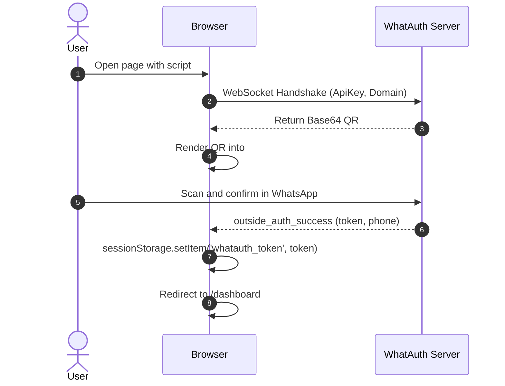
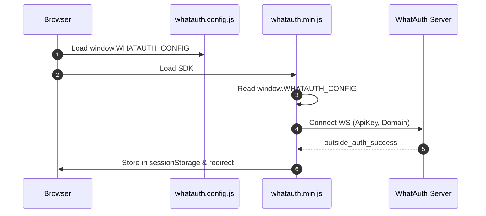
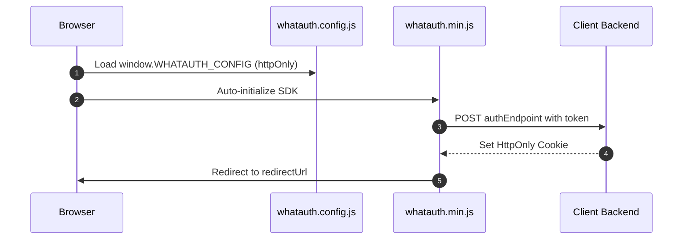

# WhatAuth CDN SDK

WhatAuth CDN 压缩版客户端 SDK (原生 JavaScript) 集成指南，支持 script 标签属性配置或全局配置文件方式。

---

## 前置准备要求

1. 在 whatauth.com 注册账号
2. 拥有有效的授权许可证
3. 在 LoginQR 模块: 自定义绑定域名、提示词、表情符号及 JWT Secret 密钥
4. 在 API 模块: 创建公钥 ApiKey

---

## 1. Script 标签属性配置 (原生 HTML)

`<script>` 标签通过读取自身的 data-* 属性完成配置并自动初始化 SDK。

### sessionStorage 模式

将 JWT 凭证保存到浏览器 sessionStorage 中，并自动执行重定向。

```html
<!-- DOM Elements -->

<a id="whatauth-link">Login with WhatsApp</a>
<div id="whatauth-expired" style="display: none;">
  <span>Session Expired</span>
  <button onclick="location.reload()">Retry</button>
</div>
<div id="whatauth-status"></div>

<!-- WhatAuth CDN Script -->
<script 
  src="https://cdn.whatauth.com/v1.0.0/whatauth.min.js" 
  data-api-key="wk_live_YOUR_API_KEY"
  data-ws-url="https://api.whatauth.com"
  data-storage="sessionStorage"
  data-redirect-url="/dashboard"
  data-domain="yourdomain.com">
</script>
```



### httpOnly 模式

通过 POST 请求将凭证发送至您的后端服务，以便设置安全的 HttpOnly Cookie。

```html
<!-- DOM Elements -->

<a id="whatauth-link">Login with WhatsApp</a>
<div id="whatauth-expired" style="display: none;">
  <span>Session Expired</span>
  <button onclick="location.reload()">Retry</button>
</div>
<div id="whatauth-status"></div>

<!-- WhatAuth CDN Script (httpOnly mode) -->
<script 
  src="https://cdn.whatauth.com/v1.0.0/whatauth.min.js" 
  data-api-key="wk_live_YOUR_API_KEY"
  data-ws-url="https://api.whatauth.com"
  data-storage="httpOnly"
  data-auth-endpoint="/api/auth/login"
  data-redirect-url="/dashboard"
  data-domain="yourdomain.com">
</script>
```

```mermaid
sequenceDiagram
    autonumber
    actor U as User
    participant B as Browser
    participant S as Client Backend
    participant WS as WhatAuth Server
    B->>WS: Connect WS with ApiKey and Domain
    WS-->>B: Emit QR Code
    U->>WS: Scan via WhatsApp
    WS-->>B: outside_auth_success (token, phone)
    B->>S: POST /api/auth/login (token, credentials: include)
    S-->>B: Set-Cookie: session=...; HttpOnly; Secure
    B->>B: Redirect to /dashboard
```

---

## 2. 全局文件 whatauth.config.js

将配置解耦到独立文件中。SDK 会自动合并配置项，无需在 `<script>` 标签内写入内联属性。

### sessionStorage 模式

```javascript
// whatauth.config.js
window.WHATAUTH_CONFIG = {
  apiKey: 'wk_live_YOUR_API_KEY',
  wsUrl: 'https://api.whatauth.com',
  domain: window.location.host,
  storage: 'sessionStorage',
  redirectUrl: '/dashboard'
};
```

```html
<!-- Load Config & CDN -->
<script src="./whatauth.config.js"></script>
<script src="https://cdn.whatauth.com/v1.0.0/whatauth.min.js"></script>
```



### httpOnly 模式

```javascript
// whatauth.config.js
window.WHATAUTH_CONFIG = {
  apiKey: 'wk_live_YOUR_API_KEY',
  wsUrl: 'https://api.whatauth.com',
  domain: window.location.host,
  storage: 'httpOnly',
  authEndpoint: '/api/auth/login',
  redirectUrl: '/dashboard'
};
```

```html
<!-- Load Config & CDN -->
<script src="./whatauth.config.js"></script>
<script src="https://cdn.whatauth.com/v1.0.0/whatauth.min.js"></script>
```



---

## 3. 参数与配置对照表

| Script 参数 | Config 属性 | 说明 |
|---|---|---|
| `data-api-key` | `apiKey` | 控制台生成的公钥 API Key (wk_live_...)。必填。 |
| `data-ws-url` | `wsUrl` | WebSocket 网关地址 (https://api.whatauth.com)。 |
| `data-domain` | `domain` | 授权域名。默认为 window.location.host。 |
| `data-storage` | `storage` | 存储模式: sessionStorage 或 httpOnly。 |
| `data-redirect-url` | `redirectUrl` | 扫码验证成功后的自动跳转目标路由。 |
| `data-auth-endpoint` | `authEndpoint` | httpOnly 模式下的后端接收 POST 路由。 |
| `data-qr-id` | `qrId` | 展示二维码的图片或容器 ID (默认: whatauth-qr)。 |
| `data-link-id` | `linkId` | WhatsApp 跳转按钮/链接 ID (默认: whatauth-link)。 |
| `data-expired-id` | `expiredId` | 过期提示遮罩层 ID (默认: whatauth-expired)。 |
| `data-status-id` | `statusId` | 连接状态文本容器 ID (默认: whatauth-status)。 |
| `data-pin-id` | `pinId` | 4位数字验证 PIN 码容器 ID (默认: whatauth-pin)。 |
